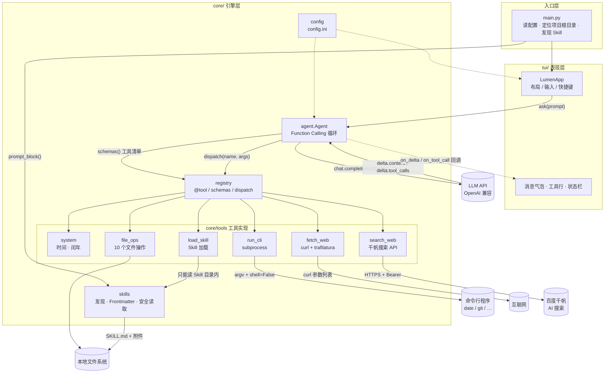
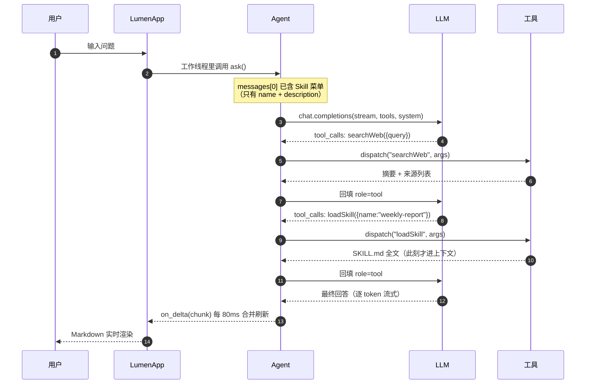

# 流明 Lumen

> 一个会调工具的终端 AI Agent。第五～七周从「单个脚本」演进到「core + tui 的产品原型」。

名字取「流明」（lumen，光通量单位）—— 工具调用的本质就是把外部世界的信息取回来，
照亮模型的上下文，让它能说事实而不是猜。

---

## 一、它现在能做什么

16 个 Function Calling 工具，覆盖四种典型实现范式：

| # | 工具 | 做什么 | 实现方式 |
| --- | --- | --- | --- |
| 1 | `getLocalTime` | 取本机当前时间 | **调用外部命令**：`subprocess` 执行本机 `date` |
| 2 | `isLeapYear` | 判断闰年 | **内部写代码**：纯 Python 计算 |
| 3 | `getCurrentDirectory` | 取当前目录 | 文件系统 API |
| 4 | `listDirectory` | 列出目录内容 | 文件系统 API |
| 5 | `getFileType` | 文件类型 / 大小 / MIME | 文件系统 API |
| 6 | `readFile` | 读取纯文本文件 | 文件系统 API |
| 7 | `writeFile` | 修改文件（覆盖 / 追加） | 文件系统 API |
| 8 | `createFile` | 新建文件 | 文件系统 API |
| 9 | `createDirectory` | 新建目录（支持多级） | 文件系统 API |
| 10 | `renamePath` | 重命名 / 移动 | 文件系统 API |
| 11 | `deleteDirectory` | 删除目录（含非空） | 文件系统 API |
| 12 | `deleteFile` | 删除文件 | 文件系统 API |
| 13 | `fetchWeb` | 抓网页正文并转 Markdown | **curl 子进程 + trafilatura** |
| 14 | `searchWeb` | 联网搜索，返回摘要与来源 | **调百度千帆 AI 搜索 API** |
| 15 | `RunCli` | 执行任意本地命令行程序 | **subprocess 参数列表 + shell=False** |
| 16 | `loadSkill` | 按需加载 Skill 说明与附件 | **文件系统 + 白名单边界** |

前两个正好是「调外部命令」与「自己算」两种范式的对照组：

- 系统已经有成熟可靠的命令（`date`、`git`、`ffmpeg`）→ **别重复造轮子，调它**；
- 逻辑只有几十行（闰年规则）→ **自己写更快更可控**，还省一次进程启动。

> Windows 提示：`date` 在 cmd 里是内置命令且带交互提问，所以 `getLocalTime`
> 按「PATH 里的 date.exe → `cmd /c date /T` + `time /T` → Python datetime 兜底」
> 三级降级，并在返回值里注明这次是哪条路取到的。

---

## 二、第七周新增的四个能力

### 1. `fetchWeb` —— 把网页读成 Markdown

两步：`subprocess` 调本地 `curl` 取 HTML，再用 `trafilatura` 抽正文转 Markdown。

**为什么不直接把整个 HTML 丢给模型？** 一个新闻页的 HTML 通常 200KB 起，
正文占不到 5%，其余全是导航、广告、脚本、页脚。抽正文能把 token 砍掉一个数量级，
而且保住了标题层级、段落、列表、表格和链接 —— 这正是模型理解页面结构需要的东西。

curl 的调用方式是关键：

```python
argv = [curl, "-sS", "-L", "--compressed", "--max-time", str(timeout),
        "-A", USER_AGENT, "-o", tmp_path, "-w", "%{http_code}\t%{content_type}", url]
subprocess.run(argv, capture_output=True, timeout=timeout + 10, shell=False)
```

- **参数列表 + `shell=False`**：URL 里的 `;` `|` `$()` 只是普通字符，不会被解释成命令；
- `-o` 写到临时文件、`-w` 只回状态码，避免把 HTML 和元信息混在一个流里；
- 编码按「HTTP 头 charset → `<meta charset>` → UTF-8 → GB18030」依次尝试。

失败路径都翻译成人话：域名解析失败 / 连接被拒 / 超时 / SSL 握手失败 / HTTP 404 /
返回的是 PDF 而非网页 / 页面是 JS 渲染导致抽不出正文（会明确建议改用 `searchWeb`）。

### 2. `searchWeb` —— 联网搜索

调百度千帆 `POST /v2/ai_search/web_search`，把 `references[]` 整理成「摘要 + 来源标题/URL/时间」。

三个设计决定：

- **API Key 从 `config.ini` 的 `[search] baidu_qianfan_api_key` 读**，不硬编码、不落日志；
  缺配置时返回的是「请去填哪一行」的指引，而不是一句 `KeyError`。
- **query 主动截断到 72 个字符**（按百度口径：一个汉字算 2），并告诉模型截了什么 ——
  服务端也会截，但模型不知道，容易以为搜的是完整问题。
- **解析做多字段名兼容**（`url|link`、`content|snippet|summary|abstract`），
  接口小改一次不至于整个工具失效。

### 3. `RunCli` —— 调用本地命令行

```python
subprocess.run([exe, *args], capture_output=True, timeout=timeout, shell=False, cwd=项目根目录)
```

三件必须做的事：

| 要求 | 做法 | 不做的后果 |
| --- | --- | --- |
| 防命令注入 | 参数列表 + `shell=False` | `args=["&&","whoami"]` 会被当命令执行 |
| 防卡死 | 默认 60 秒超时（`cli_timeout`） | `ping`、`tail -f` 让 Agent 永远转圈 |
| 防爆上下文 | stdout/stderr 各自截断并注明省略多少字符 | 一次 `cat` 大文件就烧穿窗口 |

Windows 上两个坑：

- `npm` / `yarn` / `pnpm` 实际是 `.cmd` 批处理，CreateProcess 不会自动补扩展名。
  先用 `shutil.which()`（尊重 `PATHEXT`）解析真实路径；批处理必须由 cmd 解释，
  这时用 `[cmd.exe, "/c", 批处理路径, *args]` —— 仍然是列表传参、`shell=False`。
- `dir` / `type` / `copy` 是 cmd 的**内置命令**，不是独立程序，`shell=False` 调不到。
  工具会直接说明这一点，并提示改用 `listDirectory` / `readFile` 等专用工具。

### 4. `loadSkill` —— Skill 动态加载

见下一节。

---

## 三、Skill 机制是怎么工作的

要解决的问题：**怎么让 Agent 拥有很多技能，又不把技能全塞进 System Prompt。**
20 个 Skill 的完整说明常驻上下文要吃掉几万 token，而 99% 的时间一个都用不上。

Agent Skills 规范的答案是**懒加载**：

```
启动时   扫 .agents/skills/*/SKILL.md 的 YAML Frontmatter
         → 只取 name + description（每个几十 token）
运行时   把这份「菜单」追加到 System Prompt
需要时   模型调 loadSkill(name) → 这一刻全文才进入上下文
```

这跟 Function Calling 是同一个思路：**先暴露签名，调用时才取实现**。

### 目录约定

```
<项目根目录>/.agents/skills/
    └── weekly-report/
        ├── SKILL.md            ← 必须有
        └── reference/
            └── style-guide.md  ← 可选附件，按需读取
```

项目根目录 = **程序启动时的当前工作目录**，不是 `python.exe` 的位置，也不是代码所在目录。
所以同一个 Agent 换个目录启动，就换一套技能。

`SKILL.md` 的开头必须是 YAML Frontmatter：

```markdown
---
name: weekly-report
description: 把零散的工作记录整理成结构化中文周报；用户说"写周报"时使用
---

# 周报生成

## 步骤
1. ...
```

`name` 和 `description` 都是必需字段。缺字段、缺 `SKILL.md`、名字重复的目录会被跳过，
并在启动时打印告警 —— 而不是静默失效。

### 注入到 System Prompt 的样子

```
You have access to the following skills:

- `repo-checkup`: 体检当前的 git 仓库（分支、未提交改动、最近提交、大文件）…
- `weekly-report`: 把零散的工作记录整理成一份结构化的中文周报…

Use the `loadSkill` tool to load the full instructions of a skill when needed.
You can also load additional files referenced by a skill by passing the `filename` parameter.
```

实测整段 System Prompt 只有 **1361 个字符**，而两个 Skill 的正文加起来超过 3000 字。

### `loadSkill` 的路径解析规则

| 模型传的 filename | 解析方式 |
| --- | --- |
| 不传 | 返回 `SKILL.md` 全文 |
| `reference/style-guide.md` | 相对 Skill 目录的精确路径 |
| `.agents/skills/xxx/a.md` | 项目相对路径（仅在落在本 Skill 内时生效） |
| `D:\...\a.md` | 绝对路径（必须在本 Skill 目录内） |
| `style-guide.md` | 只给文件名 → 在该 Skill 目录内递归查找 |

递归查找命中多个同名文件时，**不猜**，而是把候选路径列给模型让它自己选：

```
错误：Skill 'alpha' 内有 2 个文件都叫 'dup.md'，无法确定读哪一个。
候选路径：
  - deep/dup.md
  - sub/dup.md
请用完整相对路径重试…
```

### 边界：只读 Skill 目录内的文件

```python
real = os.path.realpath(candidate)
if not _inside(real, skill_dir):
    return "错误：拒绝读取 Skill 'xxx' 目录之外的路径。"
```

有一个细节值得单独说：**先做包含性校验，再看文件是否存在**。
反过来写会留下一个存在性探针 —— 模型传 `../../secret.txt` 时，
「存在但被拒绝」和「不存在」这两种回答本身就泄露了信息。现在无论目标是否存在，
越界请求都得到同一个答案。

---

## 四、目录结构：为什么拆成 core + tui

产品验证阶段那个「所有代码塞一个 .py」的写法，一旦超过 500 行就没法维护了。
这一步按软件工程的标准做了一次分层：**引擎不认识界面，界面不碰业务逻辑**。

```
lumen/
├── main.py                  入口：读配置 · 定位项目根目录 · 发现 Skill · 拉起 TUI（--cli 可退化）
├── core/                    引擎层 —— 可以脱离界面单独跑
│   ├── config.py            配置读取（config.ini）
│   ├── registry.py          工具注册表：@tool 装饰器 / schemas() / dispatch() / truncate()
│   ├── skills.py            Skill 发现、Frontmatter 解析、注入块、安全读取
│   ├── agent.py             Function Calling 主循环（含流式 tool_calls 归并）
│   └── tools/
│       ├── __init__.py      导入即注册
│       ├── system.py        getLocalTime、isLeapYear
│       ├── file_ops.py      10 个文件 / 目录操作
│       ├── fetch_web.py     fetchWeb：curl + trafilatura
│       ├── search_web.py    searchWeb：百度千帆 AI 搜索
│       ├── run_cli.py       RunCli：参数列表 + shell=False
│       └── load_skill.py    loadSkill：按需加载 Skill
├── tui/                     表现层 —— 只负责显示与输入
│   ├── app.py              Textual App：布局、事件、线程回调
│   └── app.tcss            样式表
├── .agents/skills/          示例 Skill（随项目启动自动发现）
│   ├── weekly-report/       写周报（含 reference/style-guide.md 附件）
│   └── repo-checkup/        git 仓库体检
├── config.example.ini       配置模板（复制成 config.ini 再填 key）
└── requirements.txt
```

分层的实际好处：

1. **可测试**。工具层不依赖界面，可以直接 `dispatch("readFile", '{"path":"a.txt"}')`
   单测，不用起终端。
2. **可换界面**。同一套 `core` 现在既能跑 TUI，也能跑 `--cli` 纯文本模式。
3. **职责清晰**。想改配色只动 `app.tcss`；想加工具只往 `core/tools/` 加一个文件。

---

## 五、架构图



一次「查下今年诺奖，再按周报模板整理」的完整往返：



> 上面两张图用的是标准 Mermaid 语法，可直接粘到 <https://mermaid.live> 验证。

---

## 六、跑起来

### 1. 装依赖

```bash
pip install -r requirements.txt
```

`textual` 没装上的话，`main.py` 会**自动降级成 CLI 模式**并在屏幕上说明缺什么 ——
界面打不开基本都是这一步没做。

### 2. 写配置

**第一次运行会自动生成** `config.ini`（从 `config.example.ini` 复制），不需要手动 copy。
生成后打开它，至少填 `[llm]` 的 `api_key`。用 DeepSeek / Kimi / 通义时记得同时改 `base_url` 和 `model` ——
模型必须支持 Function Calling。

> 没填 `api_key` 也能启动、能看到界面，只是提问时会提示配置缺失。
> 这样至少不会「一开就闪退、还不知道为什么」。

要用联网搜索，再填 `[search]` 的 `baidu_qianfan_api_key`
（[千帆控制台](https://console.bce.baidu.com/qianfan/) 创建，并开通「百度搜索」服务）。
不填只影响 `searchWeb`，其它功能照常用。

### 3. 启动

Windows 下双击 `run.bat` 即可。它会自动 `cd` 到本目录、挑一个真正能用的 Python
（跳过微软商店的占位程序）、检查依赖是否装齐，然后启动。

命令行启动：

```powershell
cd D:\LLM-Course\Agent\lumen
py main.py
```

> **为什么用 `py` 而不是 `python`？** 在中文 Windows 上，`python` 经常先命中
> `C:\Users\<你>\AppData\Local\Microsoft\WindowsApps\python.exe` —— 这是微软商店的
> **占位程序**，敲下去什么都不执行、也不报错，看起来就像「程序没反应」。
> `py` 是官方启动器，指向真正的解释器。
> 先查清楚自己在用哪个：
>
> ```powershell
> py -c "import sys; print(sys.executable)"
> ```

> **为什么必须先 cd？** 文件类工具的沙箱边界、Skill 的扫描起点，都是「启动时的当前工作目录」。
> 在 `C:\` 下直接跑，等于把整个 C 盘交给模型。

终端太窄或显示异常时，可以退化成纯命令行模式：

```powershell
py main.py --cli
```

建议终端宽度 ≥ 100 列（右侧面板固定占 46 列）。

自检（不需要 API Key，验证界面能否正常挂载与交互）：

```powershell
py smoke_tui.py
```

> `tui` 不是一个单独的文件，而是一个**目录**：`tui/app.py`（界面逻辑）+ `tui/app.tcss`（样式）。
> 没有「tui 文件」是正常的。

### 4. 加自己的 Skill

```bash
mkdir .agents\skills\my-skill
```

新建 `.agents\skills\my-skill\SKILL.md`，写上 Frontmatter（`name` + `description`）和正文，
重启即可 —— 不注册、不改代码，`loadSkill` 会自动多出一个可选项。

---

## 七、界面与快捷键

```
┌ ◆ 流明 LUMEN ──────────────── model · 16 个工具 · 2 个 Skill · v0.7.0 ┐
├───────────────────────────────────────┬──────────────────────────────┤
│ 对话区（气泡 + 工具调用轨迹）          │ 可用工具 / Skills / 状态      │
├───────────────────────────────────────┴──────────────────────────────┤
│ » 问点什么…（Enter 发送）                                            │
└──────────────────────────────────────────────────────────────────────┘
```

| 操作 | 说明 |
| --- | --- |
| `Enter` | 发送 |
| `Ctrl+L` | 清空上下文（保留 System Prompt） |
| `Ctrl+Q` | 退出 |
| `F1` | 快捷键帮助 |
| `/tools` | 列出当前所有工具 |
| `/skills` | 列出已发现的 Skill |
| `/clear` | 同 `Ctrl+L` |

对话区里每条工具调用都会留痕：

```
» searchWeb({"query": "2026 诺贝尔物理学奖"})
└ searchWeb · 搜索完成：2026 诺贝尔物理学奖
» loadSkill({"name": "weekly-report"})
└ loadSkill · Skill：weekly-report · 完整说明（SKILL.md）
```

这是刻意设计的 —— Agent 最怕「它说自己查过了但你没看到」，把调用链摊开在屏幕上，
出问题时一眼就知道是模型编的、还是工具真的失败了。侧栏里 Skill 只显示名字和一行描述，
正文要等模型真的调用 `loadSkill` 才会进上下文。

---

## 八、几个实现细节值得单独说

### 1. 流式响应里的 tool_calls 是分片的

非流式时 `message.tool_calls` 是完整数组，直接读就行。
但流式模式下它是**一片一片到达的**：先给 `index` 和 `id`，
再给 `function.name`，然后 `function.arguments` 一个字符一个字符地吐。

所以必须按 `index` 归并：

```python
slot = call_slots.setdefault(piece.index, {"id": "", "name": "", "arguments": ""})
if piece.id:                 slot["id"] = piece.id
if piece.function.name:      slot["name"] += piece.function.name
if piece.function.arguments: slot["arguments"] += piece.function.arguments
```

不归并就会拿到一堆残缺的 `{}` 参数，工具直接报参数错误。

### 2. UI 线程不能被 LLM 请求堵住

Textual 的界面刷新在主线程。直接在里面 `client.chat.completions.create(...)`
会让整个界面卡死几秒到几十秒。

```python
self.run_worker(lambda: self._run_agent(text), thread=True, exclusive=True)
...
self.call_from_thread(self._set_agent_text, snapshot)   # 线程 → UI
```

流式增量也不能每个 token 都重绘 Markdown（太贵），这里按 **80ms** 合并一次，
肉眼几乎无感，CPU 占用低一个量级。

### 3. 中文字符串不能按 `len()` 截断

侧栏只有 46 列。用 `description[:30]` 截断，30 个汉字 = 60 列，必然折行，
而且续行不带缩进，看起来就错位了。所以按**显示列宽**截：

```python
def _char_width(ch): return 2 if unicodedata.east_asian_width(ch) in ("W", "F") else 1
```

### 4. 为什么「先校验边界，再判断存在」

见第三节最后一段 —— 顺序反了，错误信息本身就成了存在性探针。

---

## 九、安全设计

这 16 个工具里有 3 个是**破坏性**的（`writeFile` / `deleteDirectory` / `deleteFile`），
还有 1 个能执行任意程序（`RunCli`）。教学环境下的处理：

1. **路径沙箱**：文件类工具的所有路径 `realpath` 之后必须落在项目根目录内：

   ```
   错误：拒绝访问项目目录之外的路径：C:\Windows\win.ini
   ```

2. **非空目录要二次确认**：`deleteDirectory` 遇到非空目录会拒绝，必须显式传 `recursive=true`。

3. **不允许删项目根目录本身**。

4. **Skill 读取边界**：`loadSkill` 只能读该 Skill 目录内的文件，向上跳目录直接拒绝。

5. **命令不经过 shell**：`RunCli` 用参数列表 + `shell=False`，
   `;` `&&` `|` 只是普通字符。`.cmd` / `.bat` 必须由 `cmd.exe` 解释，这是唯一例外，仍是列表传参。

6. **失败不抛异常**：所有工具异常都被 `dispatch` 兜成「错误：…」字符串返回给模型，
   模型才有机会换方案，而不是整个程序崩掉。

> **关于 `RunCli` 的边界**：按课程要求，本阶段**不做**命令白名单/黑名单/审批 ——
> 目的是让学生看清「模型 → 工具 → 本机进程 → 结果回填」的完整链路。
> 命令以运行 Lumen 的当前用户权限执行，**请只在你自己信任的环境里用**。
> 生产环境应该加白名单、加人工审批、或跑在容器里。

---

## 十、常见问题

**Q：报「api_key 还没填写」**
`config.ini` 里 `[llm] api_key` 还是占位符。填上真实的 key。

**Q：报 `404 model not found`**
`model` 名字和 `base_url` 对应的平台不一致。比如 DeepSeek 要用 `deepseek-chat`。

**Q：模型不调工具，直接自己编答案**
换一个支持 Function Calling 的模型。部分小模型/量化模型不支持 `tools` 参数。

**Q：`searchWeb` 报「尚未配置」**
`[search] baidu_qianfan_api_key` 没填。填上后重启。

**Q：`searchWeb` 报「鉴权失败（HTTP 401/403）」**
Key 无效、过期，或该 Key 没开通「百度搜索」服务。去千帆控制台确认。

**Q：`fetchWeb` 报「正文提取失败」**
页面是 JavaScript 动态渲染的，`curl` 拿到的是空壳 HTML。改用 `searchWeb` 找别的来源，
或者让用户直接粘贴内容。

**Q：`fetchWeb` 报「必须 http:// 或 https:// 开头」**
模型把网址写错了。这不是 bug，是拒绝执行非法 URL。

**Q：`RunCli` 说「找不到命令」**
程序没装或不在 `PATH`。可以改用完整路径，比如 `C:\Tools\foo.exe`。

**Q：`RunCli` 说「是 cmd 的内置命令」**
`dir` / `type` / `copy` 这类不是独立程序。用对应的专用工具代替。

**Q：启动时打印 `[Skill] ... 已跳过`**
那个 Skill 的 Frontmatter 缺 `name` / `description`，或名字与别的 Skill 重复。
按提示改 `SKILL.md` 即可。

**Q：`/skills` 是空的**
Skill 目录要在**启动时的工作目录**下的 `.agents\skills\`。先 `cd` 到项目根目录再启动。

**Q：TUI 显示成乱码 / 方块**
换支持中文的等宽字体（Windows Terminal 推荐「等距更纱黑体」或「Cascadia Mono + 微软雅黑」组合），
并把终端编码设为 UTF-8。

**Q：敲 `python main.py` 完全没反应，既没界面也没报错**
八成命中了微软商店的占位程序。验证一下：

```powershell
python --version        # 无输出 = 占位程序
py --version            # 有版本号 = 真的解释器
```

改用 `py main.py`，或者直接双击 `run.bat`。

**Q：`python main.py` 一闪就退出（窗口关了，看不到报错）**
在命令行里手动跑，别双击。依次确认：

1. `pip install -r requirements.txt` 是否成功 —— 缺 `textual` 会退化成 CLI，缺 `openai` 会直接报错；
2. `py smoke_tui.py` 能否 14 项全过 —— 不能的话把第一条 FAIL 的原文发出来；
3. `pwd`（PowerShell 里是 `Get-Location`）是否就是 `lumen` 目录 —— 路径不对会导致找不到 `core` 包。

**Q：装了依赖但还是说 `No module named 'textual'`**
装到了一个 Python，跑的是另一个。电脑上同时有 `py`（系统装的那个）和别的 Python 很常见。
查清楚两边分别是哪个，然后**用同一个**解释器装依赖：

```powershell
py -c "import sys; print(sys.executable)"     # 你跑代码用的
py -m pip install -r requirements.txt         # 就用它装依赖
```

**Q：`ModuleNotFoundError: No module named 'textual'`**
依赖没装，或装到了另一个 Python 环境。用 `python -m pip install textual`，
并确认 `python -c "import sys; print(sys.executable)"` 和 `pip -V` 指向同一个解释器。

**Q：`pip install` 卡住不动 / 报 `from versions: none`**
国内镜像源的相对链接会让某些 pip 版本（26.x）解析失败。改用官方源：

```bash
python -m pip install -r requirements.txt -i https://pypi.org/simple
```
