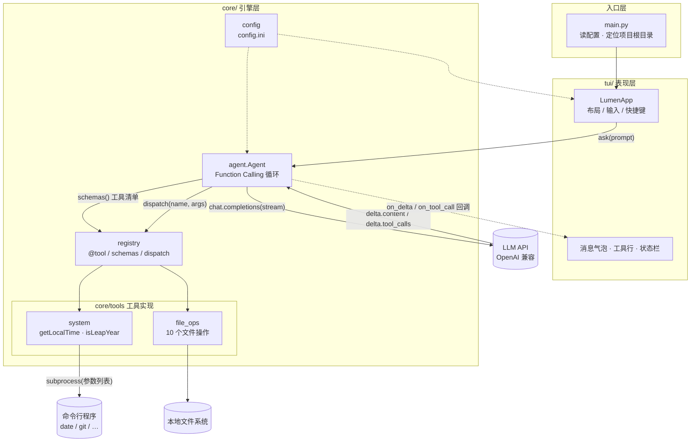
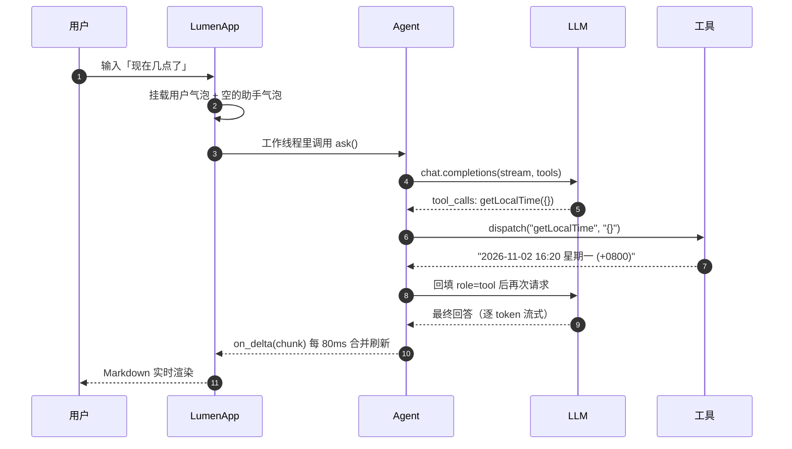

# 流明 Lumen

> 一个会调工具的终端 AI Agent。第五～七周从「单个脚本」演进到「core + tui 的产品原型」。

名字取「流明」（lumen，光通量单位）—— 工具调用的本质就是把外部世界的信息取回来，
照亮模型的上下文，让它能说事实而不是猜。

---

## 一、它现在能做什么

12 个 Function Calling 工具，覆盖了**三种典型实现范式**：

| # | 工具 | 做什么 | 实现方式 |
| --- | --- | --- | --- |
| 1 | `getLocalTime` | 取本机当前时间 | **调用外部命令**：`subprocess` 执行本机 `date` |
| 2 | `isLeapYear` | 判断闰年 | **内部写代码**：纯 Python 计算 |
| 3 | `getCurrentDirectory` | 取当前目录 | 文件系统 API |
| 4 | `listDirectory` | 列出目录内容 | 文件系统 API |
| 5 | `getFileType` | 文件类型 / 大小 / MIME | 文件系统 API |
| 6 | `readFile` | 读取纯文本文件 | 文件系统 API |
| 7 | `writeFile` | 修改文件（覆盖 / 追加） | 文件系统 API |
| 8 | `createFile` | 新建文件 | 文件系统 API |
| 9 | `createDirectory` | 新建目录（支持多级） | 文件系统 API |
| 10 | `renamePath` | 重命名 / 移动 | 文件系统 API |
| 11 | `deleteDirectory` | 删除目录（含非空） | 文件系统 API |
| 12 | `deleteFile` | 删除文件 | 文件系统 API |

前两个正好是「调外部命令」与「自己算」两种范式的对照组：

- 系统已经有成熟可靠的命令（`date`、`git`、`ffmpeg`）→ **别重复造轮子，调它**；
- 逻辑只有几十行（闰年规则）→ **自己写更快更可控**，还省一次进程启动。

> Windows 提示：`date` 在 cmd 里是内置命令且带交互提问，所以 `getLocalTime`
> 按「PATH 里的 date.exe → `cmd /c date /T` + `time /T` → Python datetime 兜底」
> 三级降级，并在返回值里注明这次是哪条路取到的。

---

## 二、目录结构：为什么拆成 core + tui

产品验证阶段那个「所有代码塞一个 .py」的写法，一旦超过 500 行就没法维护了。
这一步按软件工程的标准做了一次分层：**引擎不认识界面，界面不碰业务逻辑**。

```
lumen/
├── main.py                  入口：读配置、定位项目根目录、拉起 TUI（--cli 可退化）
├── core/                    引擎层 —— 可以脱离界面单独跑
│   ├── config.py            配置读取（config.ini）
│   ├── registry.py          工具注册表：@tool 装饰器 / schemas() / dispatch()
│   ├── agent.py             Function Calling 主循环（含流式 tool_calls 归并）
│   └── tools/
│       ├── __init__.py      导入即注册
│       ├── system.py        getLocalTime、isLeapYear
│       └── file_ops.py      10 个文件 / 目录操作
├── tui/                     表现层 —— 只负责显示与输入
│   ├── app.py              Textual App：布局、事件、线程回调
│   └── app.tcss            样式表
├── config.example.ini       配置模板（复制成 config.ini 再填 key）
└── requirements.txt
```

分层的实际好处：

1. **可测试**。工具层不依赖界面，可以直接 `dispatch("readFile", '{"path":"a.txt"}')`
   单测，不用起终端。
2. **可换界面**。同一套 `core` 现在既能跑 TUI，也能跑 `--cli` 纯文本模式。
3. **职责清晰**。想改配色只动 `app.tcss`；想加工具只动 `core/tools/`。

---

## 三、架构图



一次「现在几点了」的完整往返：



> 上面两张图用的是标准 Mermaid 语法，可直接粘到 <https://mermaid.live> 验证。

---

## 四、跑起来

### 1. 装依赖

```bash
pip install -r requirements.txt
```

### 2. 写配置

```bash
copy config.example.ini config.ini
```

然后编辑 `config.ini`，至少填 `[llm]` 的 `api_key`。
用 DeepSeek / Kimi / 通义时记得同时改 `base_url` 和 `model` —— 模型必须支持 Function Calling。

### 3. 启动

```bash
cd D:\LLM-Course\Agent\lumen
python main.py
```

> **为什么必须先 cd？** 文件类工具以「启动时的当前工作目录」为项目根目录，
> 所有路径操作都被限制在这个目录内。在 `C:\` 下直接跑，等于把整个 C 盘交给模型。

终端太窄或显示异常时，可以退化成纯命令行模式：

```bash
python main.py --cli
```

建议终端宽度 ≥ 100 列（右侧工具面板固定占 46 列）。

---

## 五、界面与快捷键

```
┌ ◆ 流明 LUMEN ──────────────── model · 12 个工具 · v0.5.0 ┐
├───────────────────────────────────┬──────────────────────┤
│ 对话区（气泡 + 工具调用轨迹）      │ 可用工具 / 状态       │
├───────────────────────────────────┴──────────────────────┤
│ » 问点什么…（Enter 发送）                                 │
└──────────────────────────────────────────────────────────┘
```

| 操作 | 说明 |
| --- | --- |
| `Enter` | 发送 |
| `Ctrl+L` | 清空上下文（保留 System Prompt） |
| `Ctrl+Q` | 退出 |
| `F1` | 快捷键帮助 |
| `/tools` | 列出当前所有工具 |
| `/clear` | 同 `Ctrl+L` |

对话区里每条工具调用都会留痕：

```
» getLocalTime()
└ getLocalTime · 本机当前时间：2026-11-02 16:20:31 Monday (+0800)
```

这是刻意设计的 —— Agent 最怕「它说自己查过了但你没看到」，把调用链摊开在屏幕上，
出问题时一眼就知道是模型编的、还是工具真的失败了。

---

## 六、两个实现细节值得单独说

### 1. 流式响应里的 tool_calls 是分片的

非流式时 `message.tool_calls` 是一个完整的数组，直接读就行。
但流式模式下，它是**一片一片到达的**：先给你 `index` 和 `id`，
再给 `function.name`，然后 `function.arguments` 一个字符一个字符地吐。

所以必须按 `index` 归并：

```python
slot = call_slots.setdefault(piece.index, {"id": "", "name": "", "arguments": ""})
if piece.id:                 slot["id"] = piece.id
if piece.function.name:      slot["name"] += piece.function.name
if piece.function.arguments: slot["arguments"] += piece.function.arguments
```

不归并就会拿到一堆残缺的 `{}` 参数，工具直接报参数错误 —— 这个坑很容易踩。

### 2. UI 线程不能被 LLM 请求堵住

Textual 的界面刷新在主线程。直接在里面 `client.chat.completions.create(...)`
会让整个界面卡死几秒到几十秒。

正确做法是把请求丢到工作线程，再用 `call_from_thread` 回到 UI 线程更新：

```python
self.run_worker(lambda: self._run_agent(text), thread=True, exclusive=True)
...
self.call_from_thread(self._set_agent_text, snapshot)   # 线程 → UI
```

同时流式增量不能每个 token 都重绘 Markdown（太贵），
这里按 **80ms** 合并一次，肉眼几乎无感，CPU 占用低一个量级。

---

## 七、安全设计

这 12 个工具里有 3 个是**破坏性**的（`writeFile` / `deleteDirectory` / `deleteFile`）。
教学环境下的处理：

1. **路径沙箱**：所有路径 `realpath` 之后必须落在项目根目录内，
   `../../` 会被 `commonpath` 检查直接拦掉：

   ```
   错误：拒绝访问项目目录之外的路径：C:\Windows\win.ini
   ```

2. **非空目录要二次确认**：`deleteDirectory` 遇到非空目录会拒绝，
   必须显式传 `recursive=true`。

3. **不允许删项目根目录本身**。

4. **失败不抛异常**：所有工具异常都被 `dispatch` 兜成「错误：…」字符串返回给模型，
   模型才有机会换方案，而不是整个程序崩掉。

---

## 八、常见问题

**Q：报「api_key 还没填写」**
`config.ini` 里 `[llm] api_key` 还是占位符。填上真实的 key。

**Q：报 `404 model not found`**
`model` 名字和 `base_url` 对应的平台不一致。比如 DeepSeek 要用 `deepseek-chat`，
而不是 `gpt-4o-mini`。

**Q：模型不调工具，直接自己编答案**
换一个支持 Function Calling 的模型。部分小模型/量化模型不支持 tools 参数。

**Q：`getLocalTime` 说「属降级结果」**
说明 PATH 里没有 `date` 命令。装了 Git for Windows 就会有，
或者忽略 —— 降级用的是 Python `datetime`，结果依然准确，只是少了「调用外部命令」这个演示意义。

**Q：TUI 显示成乱码 / 方块**
换支持中文的等宽字体（Windows Terminal 推荐「等距更纱黑体」或「Cascadia Mono + 微软雅黑」组合），
并把终端编码设为 UTF-8。
