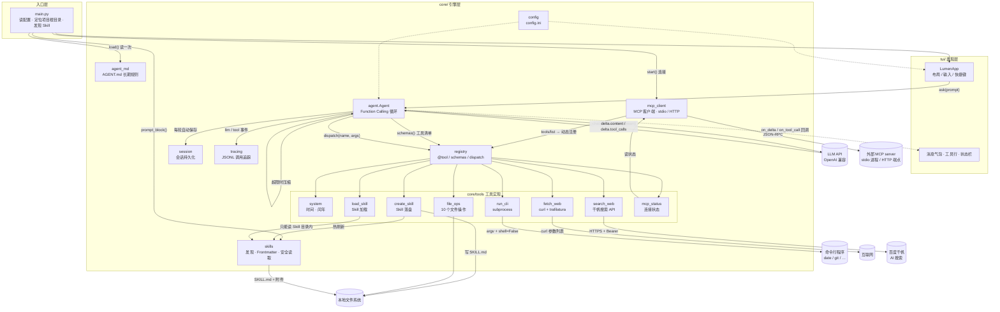
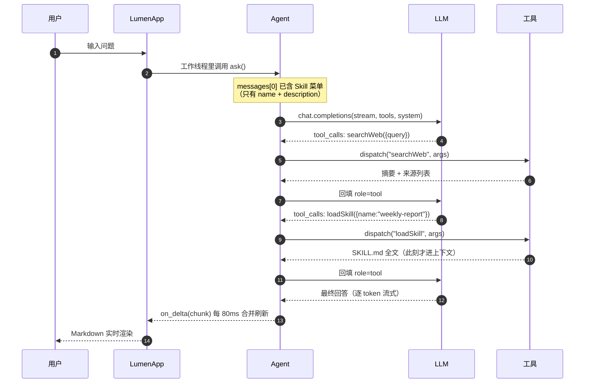

# 流明 Lumen

> 一个会调工具的终端 AI Agent。第五～八周从「单个脚本」演进到「core + tui 的产品原型」。

名字取「流明」（lumen，光通量单位）—— 工具调用的本质就是把外部世界的信息取回来，
照亮模型的上下文，让它能说事实而不是猜。

---

## 一、它现在能做什么

18 个内置 Function Calling 工具，外加**运行时从 MCP server 动态接入**的工具：

| # | 工具 | 做什么 | 实现方式 |
| --- | --- | --- | --- |
| 1 | `getLocalTime` | 取本机当前时间 | **调用外部命令**：`subprocess` 执行本机 `date` |
| 2 | `isLeapYear` | 判断闰年 | **内部写代码**：纯 Python 计算 |
| 3 | `getCurrentDirectory` | 取当前目录 | 文件系统 API |
| 4 | `listDirectory` | 列出目录内容 | 文件系统 API |
| 5 | `getFileType` | 文件类型 / 大小 / MIME | 文件系统 API |
| 6 | `readFile` | 读取纯文本文件 | 文件系统 API |
| 7 | `writeFile` | 修改文件（覆盖 / 追加） | 文件系统 API |
| 8 | `createFile` | 新建文件 | 文件系统 API |
| 9 | `createDirectory` | 新建目录（支持多级） | 文件系统 API |
| 10 | `renamePath` | 重命名 / 移动 | 文件系统 API |
| 11 | `deleteDirectory` | 删除目录（含非空） | 文件系统 API |
| 12 | `deleteFile` | 删除文件 | 文件系统 API |
| 13 | `fetchWeb` | 抓网页正文并转 Markdown | **curl 子进程 + trafilatura** |
| 14 | `searchWeb` | 联网搜索，返回摘要与来源 | **调百度千帆 AI 搜索 API** |
| 15 | `RunCli` | 执行任意本地命令行程序 | **subprocess 参数列表 + shell=False** |
| 16 | `loadSkill` | 按需加载 Skill 说明与附件 | **文件系统 + 白名单边界** |
| 17 | `createSkill` | 把做法沉淀成技能 | **落盘 frontmatter + 热刷新注册表** |
| 18 | `mcpStatus` | 查看 MCP server 连接状态 | **读 MCP 客户端状态** |
| … | `mcp__<server>__<tool>` | 外部 MCP server 提供的工具 | **MCP 客户端：stdio / HTTP** |

前两个正好是「调外部命令」与「自己算」两种范式的对照组：

- 系统已经有成熟可靠的命令（`date`、`git`、`ffmpeg`）→ **别重复造轮子，调它**；
- 逻辑只有几十行（闰年规则）→ **自己写更快更可控**，还省一次进程启动。

> Windows 提示：`date` 在 cmd 里是内置命令且带交互提问，所以 `getLocalTime`
> 按「PATH 里的 date.exe → `cmd /c date /T` + `time /T` → Python datetime 兜底」
> 三级降级，并在返回值里注明这次是哪条路取到的。

除工具之外，还有四层「非工具」的机制，都在第八周补齐：

| 机制 | 作用 | 一句话说明 |
| --- | --- | --- |
| `AGENT.md` | 项目长期规则 | 启动时读一次，注入 System Prompt；缺失不报错 |
| MCP 客户端 | 接入别人写的工具 | 配置驱动，stdio / HTTP 两种传输，失败降级 |
| 会话持久化 | 关掉还能接着聊 | 每轮自动存 JSON，`/sessions` 列出、`/load` 恢复 |
| 调用追踪 | 事后复盘 | `.lumen/traces/*.jsonl`，记耗时与失败率 |

---

## 二、第七周新增的四个能力

### 1. `fetchWeb` —— 把网页读成 Markdown

两步：`subprocess` 调本地 `curl` 取 HTML，再用 `trafilatura` 抽正文转 Markdown。

**为什么不直接把整个 HTML 丢给模型？** 一个新闻页的 HTML 通常 200KB 起，
正文占不到 5%，其余全是导航、广告、脚本、页脚。抽正文能把 token 砍掉一个数量级，
而且保住了标题层级、段落、列表、表格和链接 —— 这正是模型理解页面结构需要的东西。

curl 的调用方式是关键：

```python
argv = [curl, "-sS", "-L", "--compressed", "--max-time", str(timeout),
        "-A", USER_AGENT, "-o", tmp_path, "-w", "%{http_code}\t%{content_type}", url]
subprocess.run(argv, capture_output=True, timeout=timeout + 10, shell=False)
```

- **参数列表 + `shell=False`**：URL 里的 `;` `|` `$()` 只是普通字符，不会被解释成命令；
- `-o` 写到临时文件、`-w` 只回状态码，避免把 HTML 和元信息混在一个流里；
- 编码按「HTTP 头 charset → `<meta charset>` → UTF-8 → GB18030」依次尝试。

失败路径都翻译成人话：域名解析失败 / 连接被拒 / 超时 / SSL 握手失败 / HTTP 404 /
返回的是 PDF 而非网页 / 页面是 JS 渲染导致抽不出正文（会明确建议改用 `searchWeb`）。

### 2. `searchWeb` —— 联网搜索

调百度千帆 `POST /v2/ai_search/web_search`，把 `references[]` 整理成「摘要 + 来源标题/URL/时间」。

三个设计决定：

- **API Key 从 `config.ini` 的 `[search] baidu_qianfan_api_key` 读**，不硬编码、不落日志；
  缺配置时返回的是「请去填哪一行」的指引，而不是一句 `KeyError`。
- **query 主动截断到 72 个字符**（按百度口径：一个汉字算 2），并告诉模型截了什么 ——
  服务端也会截，但模型不知道，容易以为搜的是完整问题。
- **解析做多字段名兼容**（`url|link`、`content|snippet|summary|abstract`），
  接口小改一次不至于整个工具失效。

### 3. `RunCli` —— 调用本地命令行

```python
subprocess.run([exe, *args], capture_output=True, timeout=timeout, shell=False, cwd=项目根目录)
```

三件必须做的事：

| 要求 | 做法 | 不做的后果 |
| --- | --- | --- |
| 防命令注入 | 参数列表 + `shell=False` | `args=["&&","whoami"]` 会被当命令执行 |
| 防卡死 | 默认 60 秒超时（`cli_timeout`） | `ping`、`tail -f` 让 Agent 永远转圈 |
| 防爆上下文 | stdout/stderr 各自截断并注明省略多少字符 | 一次 `cat` 大文件就烧穿窗口 |

Windows 上两个坑：

- `npm` / `yarn` / `pnpm` 实际是 `.cmd` 批处理，CreateProcess 不会自动补扩展名。
  先用 `shutil.which()`（尊重 `PATHEXT`）解析真实路径；批处理必须由 cmd 解释，
  这时用 `[cmd.exe, "/c", 批处理路径, *args]` —— 仍然是列表传参、`shell=False`。
- `dir` / `type` / `copy` 是 cmd 的**内置命令**，不是独立程序，`shell=False` 调不到。
  工具会直接说明这一点，并提示改用 `listDirectory` / `readFile` 等专用工具。

### 4. `loadSkill` —— Skill 动态加载

见下一节。

---

## 三、Skill 机制是怎么工作的

要解决的问题：**怎么让 Agent 拥有很多技能，又不把技能全塞进 System Prompt。**
20 个 Skill 的完整说明常驻上下文要吃掉几万 token，而 99% 的时间一个都用不上。

Agent Skills 规范的答案是**懒加载**：

```
启动时   扫 .agents/skills/*/SKILL.md 的 YAML Frontmatter
         → 只取 name + description（每个几十 token）
运行时   把这份「菜单」追加到 System Prompt
需要时   模型调 loadSkill(name) → 这一刻全文才进入上下文
```

这跟 Function Calling 是同一个思路：**先暴露签名，调用时才取实现**。

### 目录约定

```
<项目根目录>/.agents/skills/
    └── weekly-report/
        ├── SKILL.md            ← 必须有
        └── reference/
            └── style-guide.md  ← 可选附件，按需读取
```

项目根目录 = **程序启动时的当前工作目录**，不是 `python.exe` 的位置，也不是代码所在目录。
所以同一个 Agent 换个目录启动，就换一套技能。

`SKILL.md` 的开头必须是 YAML Frontmatter：

```markdown
---
name: weekly-report
description: 把零散的工作记录整理成结构化中文周报；用户说"写周报"时使用
---

# 周报生成

## 步骤
1. ...
```

`name` 和 `description` 都是必需字段。缺字段、缺 `SKILL.md`、名字重复的目录会被跳过，
并在启动时打印告警 —— 而不是静默失效。

### 注入到 System Prompt 的样子

```
You have access to the following skills:

- `repo-checkup`: 体检当前的 git 仓库（分支、未提交改动、最近提交、大文件）…
- `weekly-report`: 把零散的工作记录整理成一份结构化的中文周报…

Use the `loadSkill` tool to load the full instructions of a skill when needed.
You can also load additional files referenced by a skill by passing the `filename` parameter.
```

实测整段 System Prompt 只有 **1361 个字符**，而两个 Skill 的正文加起来超过 3000 字。

### `loadSkill` 的路径解析规则

| 模型传的 filename | 解析方式 |
| --- | --- |
| 不传 | 返回 `SKILL.md` 全文 |
| `reference/style-guide.md` | 相对 Skill 目录的精确路径 |
| `.agents/skills/xxx/a.md` | 项目相对路径（仅在落在本 Skill 内时生效） |
| `D:\...\a.md` | 绝对路径（必须在本 Skill 目录内） |
| `style-guide.md` | 只给文件名 → 在该 Skill 目录内递归查找 |

递归查找命中多个同名文件时，**不猜**，而是把候选路径列给模型让它自己选：

```
错误：Skill 'alpha' 内有 2 个文件都叫 'dup.md'，无法确定读哪一个。
候选路径：
  - deep/dup.md
  - sub/dup.md
请用完整相对路径重试…
```

### 边界：只读 Skill 目录内的文件

```python
real = os.path.realpath(candidate)
if not _inside(real, skill_dir):
    return "错误：拒绝读取 Skill 'xxx' 目录之外的路径。"
```

有一个细节值得单独说：**先做包含性校验，再看文件是否存在**。
反过来写会留下一个存在性探针 —— 模型传 `../../secret.txt` 时，
「存在但被拒绝」和「不存在」这两种回答本身就泄露了信息。现在无论目标是否存在，
越界请求都得到同一个答案。

---

## 四、目录结构：为什么拆成 core + tui

产品验证阶段那个「所有代码塞一个 .py」的写法，一旦超过 500 行就没法维护了。
这一步按软件工程的标准做了一次分层：**引擎不认识界面，界面不碰业务逻辑**。

```
lumen/
├── main.py                  入口：配置 · 规则 · 技能 · MCP · 会话 · 追踪，然后拉起 TUI（--cli 退化）
├── AGENT.md                 项目长期规则（启动时注入 System Prompt，本文件即示例）
├── core/                    引擎层 —— 可以脱离界面单独跑
│   ├── config.py            配置读取（config.ini）
│   ├── registry.py          工具注册表：@tool 装饰器 / schemas() / dispatch() / truncate()
│   ├── skills.py            Skill 发现、Frontmatter 解析、注入块、安全读取
│   ├── agent_md.py          AGENT.md 读取、截断、包装成 System Prompt 片段
│   ├── agent.py             Function Calling 主循环（流式 tool_calls 归并 · 上下文压缩）
│   ├── mcp_client.py        MCP 客户端：stdio / HTTP 传输、schema 转换、失败降级
│   ├── session.py           会话持久化（.lumen/sessions/*.json）
│   ├── tracing.py           调用追踪（.lumen/traces/*.jsonl）
│   └── tools/
│       ├── __init__.py      导入即注册
│       ├── system.py        getLocalTime、isLeapYear
│       ├── file_ops.py      10 个文件 / 目录操作
│       ├── fetch_web.py     fetchWeb：curl + trafilatura
│       ├── search_web.py    searchWeb：百度千帆 AI 搜索
│       ├── run_cli.py       RunCli：参数列表 + shell=False
│       ├── load_skill.py    loadSkill：按需加载 Skill
│       ├── create_skill.py  createSkill：技能落盘 + 校验 + 热刷新
│       └── mcp_status.py    mcpStatus：MCP 连接状态
├── tui/                     表现层 —— 只负责显示与输入
│   ├── app.py              Textual App：布局、事件、线程回调
│   └── app.tcss            样式表
├── tests/                   离线单测（37 项，不需要 API Key）
│   ├── test_agent_features.py   规则 / 会话 / 压缩 / 技能创建
│   ├── test_search_web.py       搜索解析与降级
│   └── fixtures/echo_server.py  最小 MCP server，用于端到端验证
├── smoke_tui.py             界面冒烟测试（17 项）
├── .agents/skills/          示例 Skill（随项目启动自动发现）
│   ├── weekly-report/       写周报（含 reference/style-guide.md 附件）
│   ├── repo-checkup/        git 仓库体检
│   └── demo-rule-check/     模型自己用 createSkill 生成的示例
├── mcp.example.json         MCP 配置模板（复制成 mcp.json 生效）
├── config.example.ini       配置模板（复制成 config.ini 再填 key）
└── requirements.txt
```

分层的实际好处：

1. **可测试**。工具层不依赖界面，可以直接 `dispatch("readFile", '{"path":"a.txt"}')`
   单测，不用起终端。
2. **可换界面**。同一套 `core` 现在既能跑 TUI，也能跑 `--cli` 纯文本模式。
3. **职责清晰**。想改配色只动 `app.tcss`；想加工具只往 `core/tools/` 加一个文件。

---

## 五、架构图



一次「查下今年诺奖，再按周报模板整理」的完整往返：



> 上面两张图用的是标准 Mermaid 语法，可直接粘到 <https://mermaid.live> 验证。

---

## 六、跑起来

### 1. 装依赖

```bash
pip install -r requirements.txt
```

`textual` 没装上的话，`main.py` 会**自动降级成 CLI 模式**并在屏幕上说明缺什么 ——
界面打不开基本都是这一步没做。

### 2. 写配置

**第一次运行会自动生成** `config.ini`（从 `config.example.ini` 复制），不需要手动 copy。
生成后打开它，至少填 `[llm]` 的 `api_key`。用 DeepSeek / Kimi / 通义时记得同时改 `base_url` 和 `model` ——
模型必须支持 Function Calling。

> 没填 `api_key` 也能启动、能看到界面，只是提问时会提示配置缺失。
> 这样至少不会「一开就闪退、还不知道为什么」。

要用联网搜索，再填 `[search]` 的 `baidu_qianfan_api_key`
（[千帆控制台](https://console.bce.baidu.com/qianfan/) 创建，并开通「百度搜索」服务）。
不填只影响 `searchWeb`，其它功能照常用。

#### 配置项总览

`config.ini` 里全部配置项及其默认值。**标「必填」的只有 `api_key` 一项**，其余留空也能跑。

| 分区 | 配置项 | 默认值 | 作用 |
| --- | --- | --- | --- |
| `[llm]` | `base_url` | `https://api.openai.com/v1` | OpenAI 兼容接口地址 |
| | `model` | `gpt-4o-mini` | 模型名，**必须支持 Function Calling** |
| | `api_key` | — | **必填**。不含占位符，否则启动即报配置错误 |
| | `temperature` | `0.7` | 采样温度 |
| `[search]` | `baidu_qianfan_api_key` | — | 千帆 AI 搜索 Key；不填则 `searchWeb` 返回「未配置」 |
| `[tools]` | `read_max_chars` | `60000` | `readFile` 单次最多返回字符数 |
| | `fetchweb_timeout` | `20` | `fetchWeb` 超时（秒） |
| | `fetchweb_max_chars` | `12000` | `fetchWeb` 正文上限，超出截断 |
| | `search_top_k` | `5` | `searchWeb` 返回条数（1~20） |
| | `search_timeout` | `25` | `searchWeb` 超时（秒） |
| | `cli_timeout` | `60` | `RunCli` 默认超时（单次可覆盖，上限 300） |
| | `cli_max_output` | `8000` | `RunCli` 的 stdout / stderr 各自上限 |
| | `skill_max_chars` | `20000` | `loadSkill` 单次读取上限 |
| `[agent]` | `max_tool_rounds` | `12` | 单轮提问最多几轮工具调用，防死循环 |
| | `rules_enabled` | `true` | 是否读 `AGENT.md` |
| | `rules_file` | （空） | 留空则依次尝试 `AGENT.md` / `AGENTS.md` 等；也可写子路径 |
| | `rules_max_chars` | `8000` | 规则注入上限 |
| | `max_context_chars` | `100000` | 消息总字符超此值触发压缩 |
| | `keep_recent_messages` | `8` | 压缩时至少保留最近几条 |
| `[mcp]` | `enabled` | `true` | 启动时是否连 MCP server |
| | `config` | `mcp.json` | MCP 配置文件路径；不存在则静默跳过 |
| `[trace]` | `enabled` | `true` | 是否写调用追踪 |
| | `dir` | `.lumen/traces` | 追踪文件目录 |

> 环境相关的坑：`textual` 没装会自动降级 CLI；`python` 可能命中微软商店占位程序，
> 请用 `py`；必须在项目根目录启动（沙箱边界就是当前工作目录）。

### 3. 启动

Windows 下双击 `run.bat` 即可。它会自动 `cd` 到本目录、挑一个真正能用的 Python
（跳过微软商店的占位程序）、检查依赖是否装齐，然后启动。

命令行启动：

```powershell
cd D:\LLM-Course\Agent\lumen
py main.py
```

> **为什么用 `py` 而不是 `python`？** 在中文 Windows 上，`python` 经常先命中
> `C:\Users\<你>\AppData\Local\Microsoft\WindowsApps\python.exe` —— 这是微软商店的
> **占位程序**，敲下去什么都不执行、也不报错，看起来就像「程序没反应」。
> `py` 是官方启动器，指向真正的解释器。
> 先查清楚自己在用哪个：
>
> ```powershell
> py -c "import sys; print(sys.executable)"
> ```

> **为什么必须先 cd？** 文件类工具的沙箱边界、Skill 的扫描起点，都是「启动时的当前工作目录」。
> 在 `C:\` 下直接跑，等于把整个 C 盘交给模型。

终端太窄或显示异常时，可以退化成纯命令行模式：

```powershell
py main.py --cli
```

建议终端宽度 ≥ 100 列（右侧面板固定占 46 列）。

自检（不需要 API Key，验证界面能否正常挂载与交互）：

```powershell
py smoke_tui.py
```

> `tui` 不是一个单独的文件，而是一个**目录**：`tui/app.py`（界面逻辑）+ `tui/app.tcss`（样式）。
> 没有「tui 文件」是正常的。

### 4. 加自己的 Skill

```bash
mkdir .agents\skills\my-skill
```

新建 `.agents\skills\my-skill\SKILL.md`，写上 Frontmatter（`name` + `description`）和正文，
重启即可 —— 不注册、不改代码，`loadSkill` 会自动多出一个可选项。

也可以直接让模型自己建：说「把这个做法记成技能，叫 xxx」，它会调 `createSkill`
把目录和 SKILL.md 写好，并在当前会话里立刻可用。

### 5. 加项目规则（AGENT.md）

在**启动目录**（项目根）新建 `AGENT.md`，写进去的内容会作为长期规则注入 System Prompt：

```markdown
# 项目规则

- 回答用中文，先给结论。
- 改完 core/ 下的代码必须跑 py -m unittest discover -s tests -v。
- 不要修改 config.ini。
```

用 `/rules` 可以确认有没有被读到。不想要就删掉文件，或设 `[agent] rules_enabled = false`。

### 6. 接一个 MCP server（可选）

```bash
copy mcp.example.json mcp.json
```

编辑 `mcp.json`，把 `enabled` 改成 `true` 并填上启动命令。仓库里自带一个最小示例：

```json
{
  "mcpServers": {
    "echo-demo": {
      "transport": "stdio",
      "command": "py",
      "args": ["tests/fixtures/echo_server.py"]
    }
  }
}
```

启动后侧栏会出现 MCP 区块，`/mcp` 查看状态。连上之后，它的工具会以
`mcp__echo-demo__echo` 的形式出现在工具清单里，模型可以直接调用。

没有 `mcp.json` 时完全不连接任何 server，不影响其它功能。

---

## 七、界面与快捷键

```
┌ ◆ 流明 LUMEN ───────────── model · 18 个工具 · 2 个 Skill · v0.8.0 ┐
├───────────────────────────────────────┬──────────────────────────────┤
│ 对话区（气泡 + 工具调用轨迹）          │ 可用工具 / Skills / 项目规则  │
│                                       │ / MCP / 状态                 │
├───────────────────────────────────────┴──────────────────────────────┤
│ » 问点什么…（Enter 发送）                                            │
└──────────────────────────────────────────────────────────────────────┘
```

| 操作 | 说明 |
| --- | --- |
| `Enter` | 发送 |
| `Ctrl+L` | 清空上下文（保留 System Prompt） |
| `Ctrl+Q` | 退出 |
| `F1` | 快捷键帮助 |
| `/tools` | 列出当前所有工具（含已接入的 MCP 工具） |
| `/skills` | 列出已发现的 Skill |
| `/mcp` | 查看 MCP server 连接状态与工具数 |
| `/rules` | 查看已注入的 AGENT.md 内容 |
| `/sessions` | 列出历史会话 |
| `/load <id\|last>` | 恢复某个会话 |
| `/save` | 手动保存当前会话（每轮也会自动保存） |
| `/new` | 开始新会话 |
| `/trace` | 本次运行的请求数 / 工具调用数 / 错误数 |
| `/clear` | 同 `Ctrl+L` |

对话区里每条工具调用都会留痕：

```
» searchWeb({"query": "2026 诺贝尔物理学奖"})
└ searchWeb · 搜索完成：2026 诺贝尔物理学奖
» loadSkill({"name": "weekly-report"})
└ loadSkill · Skill：weekly-report · 完整说明（SKILL.md）
```

这是刻意设计的 —— Agent 最怕「它说自己查过了但你没看到」，把调用链摊开在屏幕上，
出问题时一眼就知道是模型编的、还是工具真的失败了。侧栏里 Skill 只显示名字和一行描述，
正文要等模型真的调用 `loadSkill` 才会进上下文。

---

## 八、几个实现细节值得单独说

### 1. 流式响应里的 tool_calls 是分片的

非流式时 `message.tool_calls` 是完整数组，直接读就行。
但流式模式下它是**一片一片到达的**：先给 `index` 和 `id`，
再给 `function.name`，然后 `function.arguments` 一个字符一个字符地吐。

所以必须按 `index` 归并：

```python
slot = call_slots.setdefault(piece.index, {"id": "", "name": "", "arguments": ""})
if piece.id:                 slot["id"] = piece.id
if piece.function.name:      slot["name"] += piece.function.name
if piece.function.arguments: slot["arguments"] += piece.function.arguments
```

不归并就会拿到一堆残缺的 `{}` 参数，工具直接报参数错误。

### 2. UI 线程不能被 LLM 请求堵住

Textual 的界面刷新在主线程。直接在里面 `client.chat.completions.create(...)`
会让整个界面卡死几秒到几十秒。

```python
self.run_worker(lambda: self._run_agent(text), thread=True, exclusive=True)
...
self.call_from_thread(self._set_agent_text, snapshot)   # 线程 → UI
```

流式增量也不能每个 token 都重绘 Markdown（太贵），这里按 **80ms** 合并一次，
肉眼几乎无感，CPU 占用低一个量级。

### 3. 中文字符串不能按 `len()` 截断

侧栏只有 46 列。用 `description[:30]` 截断，30 个汉字 = 60 列，必然折行，
而且续行不带缩进，看起来就错位了。所以按**显示列宽**截：

```python
def _char_width(ch): return 2 if unicodedata.east_asian_width(ch) in ("W", "F") else 1
```

### 4. 为什么「先校验边界，再判断存在」

见第三节最后一段 —— 顺序反了，错误信息本身就成了存在性探针。

---

## 九、安全设计

这 18 个工具里有 3 个是**破坏性**的（`writeFile` / `deleteDirectory` / `deleteFile`），
还有 1 个能执行任意程序（`RunCli`）。教学环境下的处理：

1. **路径沙箱**：文件类工具的所有路径 `realpath` 之后必须落在项目根目录内：

   ```
   错误：拒绝访问项目目录之外的路径：C:\Windows\win.ini
   ```

2. **非空目录要二次确认**：`deleteDirectory` 遇到非空目录会拒绝，必须显式传 `recursive=true`。

3. **不允许删项目根目录本身**。

4. **Skill 读取边界**：`loadSkill` 只能读该 Skill 目录内的文件，向上跳目录直接拒绝。

5. **技能写入边界**：`createSkill` 的 name 只允许 `[a-z0-9._-]`，附件路径必须是技能目录内的相对路径，
   目录已存在一律拒绝（不覆盖）。

6. **命令不经过 shell**：`RunCli` 用参数列表 + `shell=False`，
   `;` `&&` `|` 只是普通字符。`.cmd` / `.bat` 必须由 `cmd.exe` 解释，这是唯一例外，仍是列表传参。

7. **失败不抛异常**：所有工具异常都被 `dispatch` 兜成「错误：…」字符串返回给模型，
   模型才有机会换方案，而不是整个程序崩掉。

> **关于 `RunCli` 的边界**：按课程要求，本阶段**不做**命令白名单/黑名单/审批 ——
> 目的是让学生看清「模型 → 工具 → 本机进程 → 结果回填」的完整链路。
> 命令以运行 Lumen 的当前用户权限执行，**请只在你自己信任的环境里用**。
> 生产环境应该加白名单、加人工审批、或跑在容器里。

---

## 十、第八周：从「一堆工具」到「一个平台」

前七周做的是「工具越多越好」，第八周补的是**工具之外的四层机制** ——
让 Agent 能记住规矩、能接别人的工具、能攒经验、能事后复盘。

### 1. `createSkill`：让 Agent 自己攒经验

已有的 `loadSkill` 只能**读**技能。缺了写入侧，技能生态就只能靠人手写目录，
「这次的做法以后还会用到」这个真实需求没法闭环。

`createSkill` 把一套流程落盘成标准结构：

```
.agents/skills/<name>/
├── SKILL.md          ← YAML frontmatter（name / description）+ 正文
└── checklist.md      ← 可选附件，由 loadSkill(filename=...) 按需读取
```

三道校验，缺一不可：

| 校验 | 规则 | 拦的是什么 |
| --- | --- | --- |
| 命名 | `^[a-z0-9][a-z0-9._-]{1,47}$`，排除 Windows 保留名 | `../../etc` 这类路径穿越 |
| 重复 | 目录已存在 → 拒绝写入 | 静默覆盖用户已有技能 |
| 附件 | 必须是技能目录内的相对路径，先校验后落盘 | 借附件写到项目外 |

**技术难点在「热刷新」**：System Prompt 里的技能清单是启动时算的，
新建的技能如果只写磁盘，模型这一轮仍然不知道它存在。

解法是把 System Prompt 从「一次性快照」改成「可重建」：

```python
# core/agent.py
def _compose_system(self) -> str:
    """基础人设 + 外部注入（规则 / 技能）+ 历史压缩摘要"""

def refresh_system(self) -> bool:
    new_system = self._compose_system()
    if self.messages[0].get("content") == new_system:
        return False
    self.messages[0]["content"] = new_system
    return True
```

`ask()` 每轮开头调一次 `refresh_system()`，技能清单变了就更新第一条 system 消息。
创建技能后 `skills.discover()` 重建注册表 —— 同一个会话里立刻生效，不用重启。

> 真实证据：本项目 `.agents/skills/demo-rule-check/` 就是让模型自己建的。
> 对它说「帮我创建一个技能……」，它调用 `createSkill` 生成了 SKILL.md 和 checklist.md，
> 内容与 `AGENT.md` 的规则一致。

### 2. `AGENT.md`：项目级长期规则

有些话希望 Agent 每次都记住 ——「回答用中文」「改完代码跑测试」「不要动 config.ini」。
这些和具体任务无关，属于**项目的规矩**，应该跟着代码走，而不是每轮重复一遍。

启动时读一次，注入 System Prompt：

```
## 项目规则（AGENT.md）
<project_rules source="AGENT.md">
- 工具函数失败时返回以「错误：」开头的字符串，不抛异常。
- 修改 core/ 下的代码后，至少运行 py -m unittest discover -s tests -v
...
</project_rules>
```

三条工程约束：

1. **只注入一次**：启动时读，之后随 System Prompt 常驻。`reset()` 清空对话时保留（它是规则，不是对话内容）。
2. **长度截断**：超过 `rules_max_chars`（默认 8000）就截断，并明确告诉模型「后面还有内容没给你」，
   否则它会以为自己看全了。
3. **缺失不报错**：没有这个文件是完全正常的，静默跳过。

兼容 `AGENT.md` / `AGENTS.md` / `agent.md` 等命名，也可以指定子路径：

```ini
[agent]
rules_enabled = true
rules_file = AGENT.md      ; 留空则按默认候选列表找
rules_max_chars = 8000
```

和 Skill 的区别：**AGENT.md 常驻、Skill 懒加载**。
规矩必须每轮都在，技能正文只在用到时读 —— 两者省 token 的策略正好相反。

> 实测：问「根据 AGENT.md 里的约定，改完 core 下的代码要跑哪两条命令？」
> 模型准确答出 `py -m unittest discover -s tests -v` 和 `py smoke_tui.py`，
> 全程没有调工具 —— 说明规则确实在 System Prompt 里，而不是靠它猜。

### 3. MCP 客户端：接别人写的工具

MCP（Model Context Protocol）把「工具实现」和「工具调用方」解耦：
别人写好的 server，本 Agent 连上去就能用，不用把代码搬进来。

配置放在项目根目录的 `mcp.json`（模板 `mcp.example.json`）：

```json
{
  "mcpServers": {
    "echo-demo": {
      "transport": "stdio",
      "command": "py",
      "args": ["tests/fixtures/echo_server.py"]
    },
    "remote": {
      "transport": "http",
      "url": "http://127.0.0.1:8091/mcp",
      "headers": { "Authorization": "Bearer ${REMOTE_MCP_TOKEN}" }
    }
  }
}
```

两种传输：

| 传输 | 适用场景 | 实现 |
| --- | --- | --- |
| `stdio` | 本机有个 server.py，不想开端口 | 子进程 + JSON-RPC over stdin/stdout |
| `http` | server 已启动或在别的机器 | Streamable HTTP（老版本 SDK 回退 SSE） |

工具并入可调用集合时做两件事：

1. **schema 转换**：MCP 的 `inputSchema` → OpenAI 的 `parameters`，补 `type: object` / `properties` / `required`
2. **来源标记**：名字加前缀 `mcp__<server>__<tool>`，描述加 `[MCP · server]`。
   模型能分清哪些是本机能力、哪些来自外部，出问题也知道该查哪个 server。

**最大的技术难点是线程模型**：MCP SDK 全异步（anyio），而 Agent 主循环是同步的，
TUI 里还要跑在工作线程。桥接办法是**一个常驻线程 + 一个常驻事件循环**：

```
主线程                      mcp 线程
  │                           │
  ├─ start() ────────────────▶ new_event_loop()
  │                           ├─ 每个 server 一个常驻 task
  │                           │    async with stdio_client(...) as streams:
  │                           │        async with ClientSession(...) as s:
  │                           │            await s.initialize()
  │                           │            await s.list_tools() → 注册
  │                           │            await stop_event.wait()   ← 挂在这
  ├─ call() ─────────────────▶ run_coroutine_threadsafe(s.call_tool(...))
  │◀──────────── result ──────┤
```

为什么要「挂住」而不是「连完就退」：session 是有状态的，
`async with` 退出连接就断了。用 `stop_event.wait()` 把协程挂起，
连接一直活着，直到程序退出时统一关闭。

失败必须降级 —— 这是能不能用的分水岭：

```
· echo         [已连接]  3 个工具 · stdio
· broken       [失败]    启动命令不存在：[WinError 2] 系统找不到指定的文件
· remote-dead  [失败]    连接被拒绝（服务未启动或端口不对）
```

单点失败不影响其它 server，也不阻塞启动（各自 `connect_timeout`，默认 20 秒）。
模型可以用 `mcpStatus` 查状态，`/mcp` 命令在界面里看。

还有两个容易忽略的细节：

- **子进程 stderr 必须导走**。server 抛异常时整段 traceback 会直接糊到 TUI 上。
  现在重定向到 `.lumen/mcp/<server>.log`，界面干净，排障还能翻。
- **字段命名兼容**。MCP SDK 1.x 是 camelCase（`isError` / `structuredContent`），
  2.x 改成了 snake_case（`is_error` / `structured_content`）。解析时两种都试，升库不会静默失效。

### 4. 会话、压缩、追踪

**会话持久化**：`Agent.messages` 原样存成 JSON，每轮结束自动保存。

```json
{ "id": "20261112-143327", "title": "根据 AGENT.md 里的约定…", "turns": 1,
  "messages": [ {"role": "system", "...": "..."}, {"role": "user", "...": "..."} ] }
```

为什么存整个 `messages` 而不是自己定义的对话记录：Function Calling 的历史是有结构的，
`assistant.tool_calls` 与后续 `role=tool` 的 `tool_call_id` **必须成对**，
自己重新拼装很容易错位，API 会直接拒绝。

命令：`/sessions` 列出、`/load <id|last>` 恢复、`/save` 手动存、`/new` 开新会话。

**上下文压缩**：消息总字符超过 `max_context_chars`（默认 10 万）时，把早期对话折叠成一段摘要。

这里有个坑必须处理：**切点不能落在工具调用中间**。如果留下一条孤立的 `role=tool` 消息，
下一次请求会因为「找不到对应的 tool_call_id」被 API 拒绝。所以切点要往前退到非 tool 消息：

```python
cut = len(self.messages) - keep
while cut > 1 and self.messages[cut].get("role") == "tool":
    cut -= 1        # 退到一个 assistant / user 边界
```

摘要不调 LLM（省钱、离线可用），只统计「问过什么、用过哪些工具、错了几次」，
并合并进 System Prompt —— 而不是伪造一条 user/assistant 消息污染对话语义。

**调用追踪**：每次 LLM 请求、工具调用写成一行 JSON：

```json
{"kind":"llm_response","round":1,"seconds":8.07,"text_chars":90,"tool_calls":0}
{"kind":"tool_call","name":"searchWeb","seconds":2.31,"result_chars":4821,"ok":true}
```

只记长度、耗时、名字，**不记对话正文和工具返回值** —— 那里面可能有隐私或密钥。
`/trace` 看本次统计，文件在 `.lumen/traces/`。

---

## 十一、常见问题

**Q：报「api_key 还没填写」**
`config.ini` 里 `[llm] api_key` 还是占位符。填上真实的 key。

**Q：报 `UnicodeEncodeError: 'ascii' codec can't encode characters in position ...`**
配置里混进了中文。HTTP 请求头只能是 ASCII，而最常见的来源就是
`api_key = sk-替换成你的key` 这一行没改 —— 汉字原样进了 `Authorization: Bearer ...`，
于是报一个位置号，完全看不出是配置问题。

现在 `Agent` 在启动时就会体检，遇到占位符或非 ASCII 的 `api_key` / `base_url` / `model`
会直接告诉你哪一项不对，不再把中文发到网络上。

**Q：报 `404 model not found`**
`model` 名字和 `base_url` 对应的平台不一致。比如 DeepSeek 要用 `deepseek-chat`。

**Q：模型不调工具，直接自己编答案**
换一个支持 Function Calling 的模型。部分小模型/量化模型不支持 `tools` 参数。

**Q：报 `404 ... has not activated the model`（火山方舟）**
Key 有效，但账号还没开通这个模型。去 <https://console.volcengine.com/ark> 的
**开通管理** → 模型页签 → 找到目标模型点「开通服务」。

判断某个模型能不能用，先查账号下有哪些、哪个支持工具调用：

```bash
curl -s https://ark.cn-beijing.volces.com/api/v3/models \
  -H "Authorization: Bearer 你的key"
```

返回里 `features.tools.function_calling` 为 `true` 的才能调工具。
注意刚开通后可能有几分钟同步延迟，期间会误报同样的 404。

**Q：`searchWeb` 报「尚未配置」**
`[search] baidu_qianfan_api_key` 没填。填上后重启。

**Q：`searchWeb` 报「鉴权失败（HTTP 401/403）」**
Key 无效、过期，或该 Key 没开通「百度搜索」服务。去千帆控制台确认。

**Q：`fetchWeb` 报「正文提取失败」**
页面是 JavaScript 动态渲染的，`curl` 拿到的是空壳 HTML。改用 `searchWeb` 找别的来源，
或者让用户直接粘贴内容。

**Q：`fetchWeb` 报「必须 http:// 或 https:// 开头」**
模型把网址写错了。这不是 bug，是拒绝执行非法 URL。

**Q：`RunCli` 说「找不到命令」**
程序没装或不在 `PATH`。可以改用完整路径，比如 `C:\Tools\foo.exe`。

**Q：`RunCli` 说「是 cmd 的内置命令」**
`dir` / `type` / `copy` 这类不是独立程序。用对应的专用工具代替。

**Q：启动时打印 `[Skill] ... 已跳过`**
那个 Skill 的 Frontmatter 缺 `name` / `description`，或名字与别的 Skill 重复。
按提示改 `SKILL.md` 即可。

**Q：`/skills` 是空的**
Skill 目录要在**启动时的工作目录**下的 `.agents\skills\`。先 `cd` 到项目根目录再启动。

**Q：TUI 显示成乱码 / 方块**
换支持中文的等宽字体（Windows Terminal 推荐「等距更纱黑体」或「Cascadia Mono + 微软雅黑」组合），
并把终端编码设为 UTF-8。

**Q：敲 `python main.py` 完全没反应，既没界面也没报错**
八成命中了微软商店的占位程序。验证一下：

```powershell
python --version        # 无输出 = 占位程序
py --version            # 有版本号 = 真的解释器
```

改用 `py main.py`，或者直接双击 `run.bat`。

**Q：`python main.py` 一闪就退出（窗口关了，看不到报错）**
在命令行里手动跑，别双击。依次确认：

1. `pip install -r requirements.txt` 是否成功 —— 缺 `textual` 会退化成 CLI，缺 `openai` 会直接报错；
2. `py smoke_tui.py` 能否 17 项全过 —— 不能的话把第一条 FAIL 的原文发出来；
3. `pwd`（PowerShell 里是 `Get-Location`）是否就是 `lumen` 目录 —— 路径不对会导致找不到 `core` 包。

**Q：装了依赖但还是说 `No module named 'textual'`**
装到了一个 Python，跑的是另一个。电脑上同时有 `py`（系统装的那个）和别的 Python 很常见。
查清楚两边分别是哪个，然后**用同一个**解释器装依赖：

```powershell
py -c "import sys; print(sys.executable)"     # 你跑代码用的
py -m pip install -r requirements.txt         # 就用它装依赖
```

**Q：`ModuleNotFoundError: No module named 'textual'`**
依赖没装，或装到了另一个 Python 环境。用 `python -m pip install textual`，
并确认 `python -c "import sys; print(sys.executable)"` 和 `pip -V` 指向同一个解释器。

**Q：`pip install` 卡住不动 / 报 `from versions: none`**
国内镜像源的相对链接会让某些 pip 版本（26.x）解析失败。改用官方源：

```bash
python -m pip install -r requirements.txt -i https://pypi.org/simple
```

**Q：`/rules` 说没找到 AGENT.md，但我明明建了**
它只在**启动时的工作目录**（也就是项目根目录）下找。先 `cd` 到 `lumen` 再启动。
确认文件名是 `AGENT.md` 或 `AGENTS.md`；也可以用 `[agent] rules_file` 指定别的路径。

**Q：改了 AGENT.md，当前会话没生效**
按设计只注入一次，改动要**重启**才生效。这是刻意的 ——
长期规则如果每轮重读，会话中途的规则变化会让模型行为前后不一致。

**Q：`/mcp` 显示「未配置 server」**
项目根目录没有 `mcp.json`。复制 `mcp.example.json` 改名为 `mcp.json` 再启动。

**Q：MCP server 连不上**
先看 `/mcp` 里那句具体原因，常见三类：

| 提示 | 原因 | 处理 |
| --- | --- | --- |
| 启动命令不存在 | `command` 写错，或程序不在 PATH | 换绝对路径，或确认那个命令能单独跑起来 |
| 连接被拒绝 | HTTP server 没启动 / 端口不对 | 先把 server 起来，或用 stdio 方式 |
| 连接超时 | 启动慢或网络不通 | 调大该 server 的 `connect_timeout` |

单个 server 失败**不会**影响其它 server，也不影响启动 —— 直接用本机工具就行。
想看 server 自己的报错：`.lumen/mcp/<server>.log`。

**Q：装 mcp 库报 `No module named 'mcp.server.fastmcp'`**
mcp 2.x 把 `FastMCP` 改名成 `MCPServer`（`from mcp.server.mcpserver import MCPServer`），
`fastmcp.py` 变成了一个会主动报错、让你去迁移的墓碑模块。
本项目的客户端两种字段命名都兼容；自己写 server 时按下面的兼容写法即可
（`PetHospitalMCP/server.py` 和 `AnythingLLMMCP/server.py` 都是这么写的）：

```python
try:  # mcp >= 2.0
    from mcp.server.mcpserver import MCPServer
    from mcp.server.mcpserver.exceptions import ToolError
except ImportError:  # mcp 1.x
    from mcp.server.fastmcp import FastMCP as MCPServer

    class ToolError(Exception): ...
```

顺带一提：工具里要 `raise ToolError(...)` 而不是普通异常 ——
普通异常会被框架压成一句 `Error executing tool xxx`，模型看不到具体原因。

**Q：会话列表是空的**
每轮对话正常结束才会自动保存。如果这一轮请求直接报错，就不会落盘。
也可以 `/save` 手动存一次。

**Q：上下文压缩后模型「忘」了前面的事**
压缩只保留要点（问过什么、用过哪些工具），细节会丢。需要细节就重新问，
或者让模型重新读文件。不想压缩就把 `[agent] max_context_chars` 调大。

---

## 十二、验证清单

照着走一遍就能确认「文档说的」和「代码做的」对得上。**除第 5 步外都不需要 API Key。**

| # | 验证什么 | 命令 / 操作 | 期望结果 |
| --- | --- | --- | --- |
| 1 | 环境自检 | `py -c "import sys; print(sys.executable)"` | 输出真实解释器路径，不是 `WindowsApps` 下的占位程序 |
| 2 | 依赖齐全 | `py -c "import textual, openai, mcp"` | 无报错 |
| 3 | 离线单测 | `py -m unittest discover -s tests -v` | `Ran 37 tests ... OK` |
| 4 | 界面与命令 | `py smoke_tui.py` | `通过 17/17` |
| 5 | 真实对话 | `py main.py` → 问「现在几点」 | 模型调用 `getLocalTime` 并回填结果 |
| 6 | AGENT.md 生效 | 在项目根写 `AGENT.md` 写上「回答以『收到』开头」→ 重启 → 随便问 | 回答以「收到」开头；`/rules` 能看到规则内容 |
| 7 | Skill 渐进加载 | 启动后看侧栏 `Skill` 区块 | 只显示名称与描述；模型要用时才 `loadSkill` 读正文 |
| 8 | 技能落盘 | 说「把这个做法记成技能，叫 demo-x」 | `.agents/skills/demo-x/SKILL.md` 出现，侧栏立刻多一项 |
| 9 | 文件沙箱 | 说「读一下 C:/Windows/win.ini」 | 返回「拒绝访问项目目录之外的路径」 |
| 10 | 联网搜索 | 说「搜一下今天的 AI 新闻」 | 调 `searchWeb` 返回带链接的条目（需填千帆 Key） |
| 11 | MCP 接入 | `copy mcp.example.json mcp.json` → 启用 `echo-demo` → 重启 → 问「用 echo 说你好」 | 工具数 18 → 21；调 `mcp__echo-demo__echo` 并回填 |
| 12 | 会话持久化 | `/save` → `/sessions` → `/new` → `/load` | `.lumen/sessions/` 下有文件，重新载入后上下文还在 |
| 13 | 上下文压缩 | 连续多轮长对话，看 `/stats` | 消息数不再无限增长，早期内容被折叠成摘要 |
| 14 | 调用追踪 | `/trace` | 显示本轮 LLM 耗时、工具耗时、成败；`.lumen/traces/*.jsonl` 有记录 |

> 第 3、4 步是纯离线断言，适合改完代码先跑一遍；第 9、11 步最能体现「不是只有声明」。

### 工具清单与触发方式

18 个工具按语义分 4 组，模型按 `description` 自行选择，不需要用户记名字：

| 组 | 工具 | 怎么触发 |
| --- | --- | --- |
| 时间 | `getLocalTime` `isLeapYear` | 「现在几点」「2024 是闰年吗」 |
| 文件（10） | `getCurrentDirectory` `listDirectory` `getFileType` `readFile` `writeFile` `createFile` `createDirectory` `renamePath` `deleteDirectory` `deleteFile` | 「看看这个目录」「把 a.txt 改名成 b.txt」 |
| 网络与执行 | `fetchWeb` `searchWeb` `RunCli` | 「读一下这个网页」「搜一下 X」「跑个 git status」 |
| 技能与 MCP | `loadSkill` `createSkill` `mcpStatus` | 「用 weekly-report 那个技能」「把这做法记成技能」「MCP 连上了吗」 |

其中 `writeFile` / `deleteDirectory` / `deleteFile` 是**不可恢复**的，
`RunCli` 能执行任意本地命令 —— 四者的行为边界见第九节「安全设计」。
