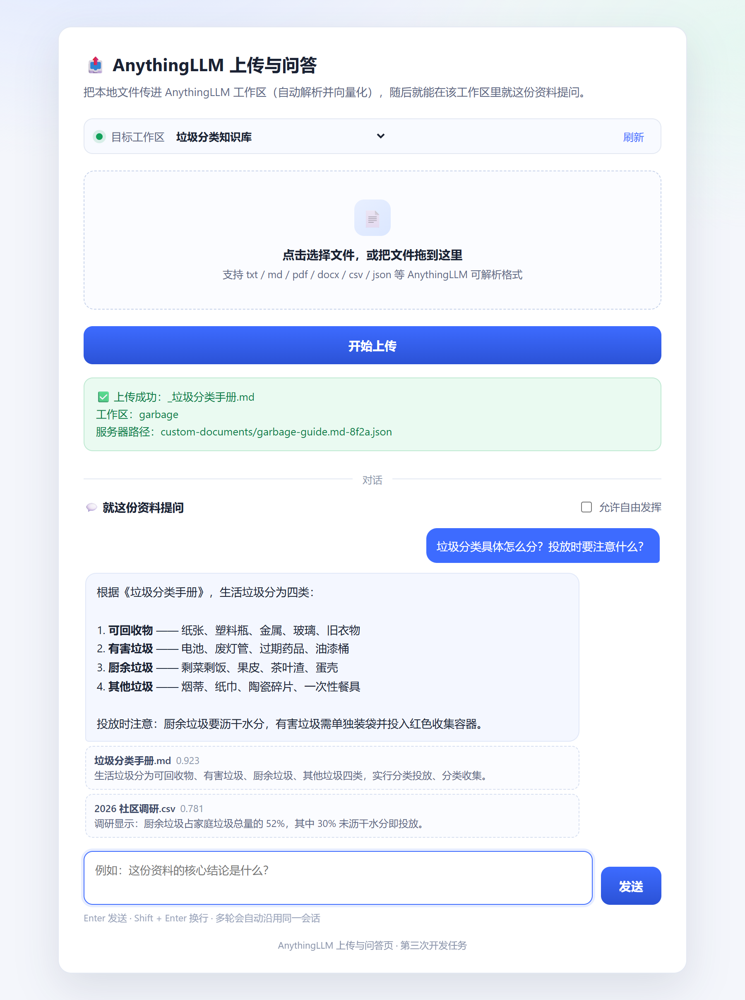

# AnythingLLMServer · 上传与问答网页 + 服务

> 第三次开发任务

一个「简单、美观」的双功能网页：**上传文件**进 AnythingLLM 工作区并自动向量化，
**就这份资料提问**（流式回答 + 引用来源 + 多轮上下文）。

```
AnythingLLMServer/
├── index.html        网页（拖拽上传 / 工作区切换 / 流式问答）
├── server.py         后端：托管网页 + 转发上传 + 把对话统一成 SSE
└── requirements.txt
```

---

## 一、先启动 AnythingLLM

打开 AnythingLLM 桌面端，确认至少有一个工作区，端口为 **3001**。

## 二、安装依赖并启动

```bash
pip install -r requirements.txt
python server.py
```

浏览器打开 <http://127.0.0.1:8092/>。

### 命令行参数 / 环境变量

| 参数 | 环境变量 | 默认值 | 说明 |
| --- | --- | --- | --- |
| `--host` | — | `127.0.0.1` | 监听地址 |
| `--port` | — | `8092` | 监听端口（8090/8091 已被另外两个任务占用） |
| `--api` | `ANYTHINGLLM_API` | `http://127.0.0.1:3001` | AnythingLLM 后端地址 |
| `--key` | `ANYTHINGLLM_API_KEY` | 空 | 开发者 API Key，留空则走本地免鉴权通道 |
| `--workspace` | `ANYTHINGLLM_WORKSPACE` | 空 | 指定目标工作区，留空 = 第一个工作区 |
| — | `ANYTHINGLLM_TIMEOUT` | `120` | 单次请求超时（大文件向量化较慢，默认放宽） |

> **关于鉴权**：上传和列工作区这类接口在本地是免鉴权的，不填 Key 也能用。
> **但对话必须用 Key** —— AnythingLLM 的 chat 接口只挂在 `/api/v1/*` 下。
> 可在 **设置 → API Keys** 生成后通过 `ANYTHINGLLM_API_KEY` 传入。

> **关于系统代理**：后端对 `127.0.0.1` 这类本机地址强制直连（`trust_env=False`）。
> 否则开着 Clash 之类代理时，连本地 3001 也会被丢给代理，代理回 502，
> 页面报「连不上 AnythingLLM」但本地服务其实好好的。

## 三、页面功能



> 实际运行截图：上传成功后下方展开对话区，回答流式输出，末尾附命中的文档片段与相关度。

### 上传

- 点击或拖拽选择文件，显示文件名与大小，可随时移除重选
- 上传进度条（浏览器 → 本服务，以及等待向量化的过程）
- 顶部下拉框切换目标工作区，右侧「刷新」重新拉取列表
- 成功 / 失败都有明确中文提示，失败会带上 AnythingLLM 的原始错误

### 问答

- **流式输出**：回答逐字出现，不用干等到最后
- **引用来源**：回答下列出命中的文档片段与相关度分数，可以核对依据
- **多轮上下文**：同一工作区内连续提问会自动沿用同一会话；切换工作区即清空重来
- **两种模式**：默认 `query`（只依据文档回答，不易编造）；勾选「允许自由发挥」切到 `chat`（模型可结合自身知识）
- 加载 / 成功 / 失败三态齐全：等待时有光标闪烁，出错时气泡变红并给出可操作提示

> 快捷键：`Enter` 发送，`Shift + Enter` 换行。

## 四、接口

| 方法 | 路径 | 说明 |
| --- | --- | --- |
| `GET` | `/` | 网页 |
| `GET` | `/api/workspaces` | 工作区列表，`{"success":true,"workspaces":[{name,slug}]}` |
| `POST` | `/api/upload` | 表单字段 `file`（必填）、`slug`（可选）；返回 `{success, workspace, location}` |
| `POST` | `/api/chat` | JSON `{message, slug?, mode?, sessionId?, stream?}`；返回 `text/event-stream` |
| `GET` | `/api/health` | 健康检查，含 `has_key` |

### `/api/chat` 的 SSE 事件

后端把「有 Key 转发上游流式」「无 Key 包装阻塞结果」两种上游差异吸收掉，
前端只解析下面五种事件：

| 事件 | 载荷 | 含义 |
| --- | --- | --- |
| `session` | `sessionId` | 本次会话标识，多轮时原样带回 |
| `delta` | `text` | 一段增量文本，追加到当前气泡 |
| `sources` | `sources[]` | 命中的文档片段（`title` / `score` / `snippet`） |
| `error` | `message` | 可读错误，前端展示为红色气泡 |
| `done` | `workspace` / `mode` | 流结束标记 |

命令行直接测：

```bash
# 上传
curl -F "file=@D:\test.txt" http://127.0.0.1:8092/api/upload

# 提问（保持连接看流式输出）
curl -N -X POST http://127.0.0.1:8092/api/chat \
  -H "Content-Type: application/json" \
  -d "{\"message\":\"这个文件讲了什么\",\"slug\":\"my-workspace\",\"mode\":\"query\"}"
```

## 五、上传后如何验证

1. 回到 AnythingLLM，进入目标工作区
2. 展开右上角的文档列表（或点 **Documents**）
3. 应该能看到刚上传的文件名；状态从 `Processing` 变成可用的绿点
4. 在本页对话区问「这个文件讲了什么」，若回答下方出现 `sources` 引用即说明成功

## 六、常见问题

| 现象 | 原因与处理 |
| --- | --- |
| 页面显示「未连接」 | AnythingLLM 没打开，或端口不是 3001；用 `--api` 指定 |
| 上传返回 502 | 后端地址不对，或工作区列表为空（先去 AnythingLLM 新建工作区） |
| 上传成功但工作区里看不到 | 大文件向量化需要时间，稍等后刷新；也可能是上传到了别的工作区，看页面顶部提示 |
| 超过 200MB 报错 | 后端限制了单文件 200MB，可在 `server.py` 里调整 `MAX_CONTENT_LENGTH` |
| **对话报「需要 API Key」** | chat 只走 `/api/v1/*`，去 **设置 → API Keys** 建一个，配 `ANYTHINGLLM_API_KEY` |
| **回答是「（没有返回内容…）」** | 该工作区里没有已向量化的文档 —— 先上传，或去 AnythingLLM 里确认文档已是绿点 |
| 开着代理时连不上 3001 | 已在后端对本地地址强制直连；若仍失败，检查是不是把 `--api` 指到了远端地址 |
| 端口被占用 | `python server.py --port 8099` |
