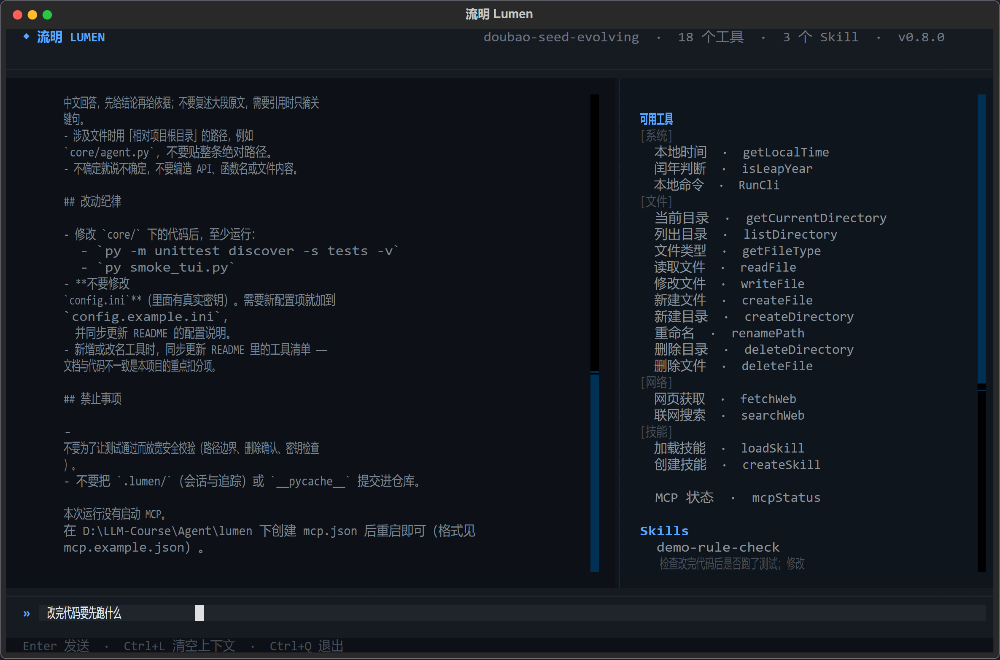
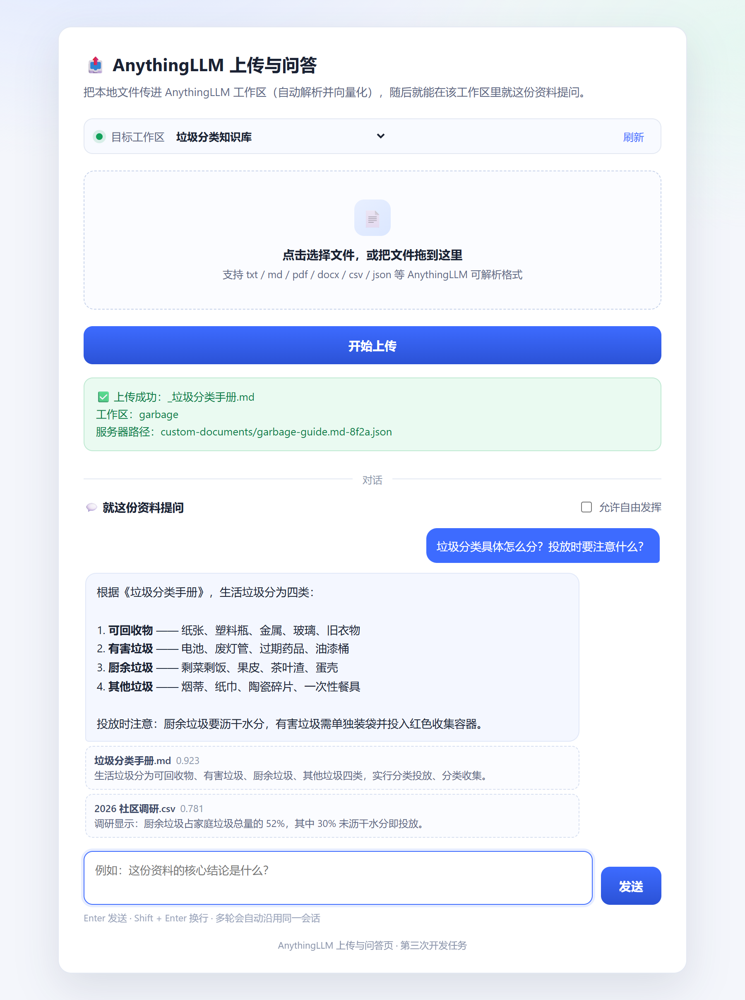

# LLM 课程作业 · 开发任务

本仓库是 LLM 课程各阶段开发任务的实现，按任务分目录组织。

| # | 目录 | 任务 | 交付物 | 端口 |
| --- | --- | --- | --- | --- |
| 1 | [`PetHospitalMCP/`](PetHospitalMCP/) | 第一次开发任务 | 把宠物医院 REST API 包装成 MCP 服务器 | 8090（HTTP 模式） |
| 2 | [`AnythingLLMMCP/`](AnythingLLMMCP/) | 第二次开发任务 | AnythingLLM MCP 服务器（Streamable HTTP）：工作区管理 + 文档上传向量化 + 检索问答 | 8091 |
| 3 | [`AnythingLLMServer/`](AnythingLLMServer/) | 第三次开发任务 | 上传与问答网页 + 转发服务：上传即向量化，可就资料流式提问 | 8092 |
| 4 | [`Agent/Practice01/`](Agent/Practice01/) | 第四周开发任务 | 调用大模型：单次请求 → 流式 → 多轮流式对话 | — |
| 5 | [`Agent/lumen/`](Agent/lumen/) | 第五～八周开发任务 | **流明 Lumen**：18 个 Function Calling 工具 + MCP 客户端（动态接入外部工具）+ AGENT.md 规则注入 + 技能创建/加载 + 会话持久化 + core/tui 分层 + Textual TUI | — |

## 界面预览

| 流明 Lumen（TUI Agent） | AnythingLLM 上传与问答页 |
| --- | --- |
|  |  |

截图均为真实运行结果：TUI 那张由 Textual 的 `save_screenshot()` 导出，
网页那张由无头浏览器实际操作（选文件 → 上传 → 提问 → 等流式结束）后截取。

---

## 目录结构

```text
.
├── .gitignore
├── README.md
├── PetHospitalMCP/
│   ├── server.py            MCP 服务器（15 个工具 · 重试 · 结构化错误 · 调用日志）
│   ├── test_server.py       离线单测 10 项（不需要后端）
│   ├── check_stdio.py       协议层联调自检（自己起客户端连上来）
│   ├── requirements.txt
│   └── README.md
├── AnythingLLMMCP/
│   ├── server.py            Streamable HTTP，端口 8091（9 个工具）
│   ├── test_server.py       离线单测 23 项（MockTransport，不需要 AnythingLLM）
│   ├── requirements.txt
│   └── README.md
├── AnythingLLMServer/
│   ├── index.html           上传 + 流式问答网页
│   ├── server.py            静态托管 + 上传转发 + 对话 SSE 适配
│   ├── requirements.txt
│   └── README.md
└── Agent/
    ├── Practice01/
    │   ├── main.py               单次请求
    │   ├── main-stream.py        流式输出
    │   ├── main-stream-loop.py   多轮流式对话
    │   ├── config.example.ini
    │   ├── requirements.txt
    │   └── README.md
    └── lumen/                    流明 Lumen · 产品原型
        ├── main.py               入口（--cli 可退化到纯命令行）
        ├── core/                 引擎层
        │   ├── config.py         配置读取
        │   ├── registry.py       工具注册表（@tool / schemas / dispatch）
        │   ├── skills.py         Skill 发现 / Frontmatter / 安全读取
        │   ├── agent_md.py       AGENT.md 项目规则注入
        │   ├── agent.py          Function Calling 循环（流式 · 上下文压缩）
        │   ├── mcp_client.py     MCP 客户端（stdio / HTTP）
        │   ├── session.py        会话持久化
        │   ├── tracing.py        调用追踪
        │   └── tools/
        │       ├── system.py     getLocalTime · isLeapYear
        │       ├── file_ops.py   10 个文件 / 目录操作
        │       ├── fetch_web.py  fetchWeb：curl + trafilatura
        │       ├── search_web.py searchWeb：百度千帆 AI 搜索
        │       ├── run_cli.py    RunCli：argv + shell=False
        │       ├── load_skill.py loadSkill：按需加载 Skill
        │       ├── create_skill.py createSkill：技能落盘
        │       └── mcp_status.py mcpStatus：MCP 连接状态
        ├── .agents/skills/       示例 Skill（weekly-report / repo-checkup / demo-rule-check）
        ├── tests/                离线单测 48 项 + 测试用 MCP server
        ├── tui/                  表现层
        │   ├── app.py            Textual App
        │   └── app.tcss          样式表
        ├── AGENT.md              项目规则示例
        ├── mcp.example.json      MCP 配置模板
        ├── config.example.ini
        ├── requirements.txt
        └── README.md
```

## 环境准备

| 依赖 | 用途 | 获取方式 |
| --- | --- | --- |
| Python 3.10+ | 运行全部任务 | python.org |
| **pethospital.exe** | 任务 1 的后端（宠物医院 REST API） | 课程提供的发行包，解压后双击运行 |
| **AnythingLLM** | 任务 2、3 的后端 | 官网下载桌面端并打开 |

> 任务 4 只需要能访问任意「OpenAI 兼容」接口的 API Key，不需要上面两个后端。

## 快速上手

### 任务 1 · PetHospitalMCP

```bash
# 1) 先双击 pethospital.exe 启动后端
cd PetHospitalMCP
pip install -r requirements.txt
python server.py                 # stdio，供客户端拉起
python server.py --http          # 或 Streamable HTTP -> http://127.0.0.1:8090/mcp

# 2) 不接 AI 客户端也能自测
python -m unittest test_server   # 离线单测，不需要后端
python check_stdio.py            # 真实走一遍握手 + 调工具
```

### 任务 2 · AnythingLLMMCP

```bash
# 1) 先打开 AnythingLLM 桌面端
cd AnythingLLMMCP
pip install -r requirements.txt
python server.py                 # http://127.0.0.1:8091/mcp
```

工作区管理类的只读工具不需要 Key；上传、向量化、问答要走
`/api/v1/*`，需在 AnythingLLM 的 **设置 → API Keys** 建一个并配到
`ANYTHINGLLM_API_KEY`。离线单测不依赖 AnythingLLM：

```bash
python -m unittest test_server -v      # 23 项
```

### 任务 3 · AnythingLLMServer

```bash
cd AnythingLLMServer
pip install -r requirements.txt
python server.py                 # 浏览器打开 http://127.0.0.1:8092/
```

页面上先上传文件（自动向量化），再在下方对话区就这份资料提问。
问答需要 `ANYTHINGLLM_API_KEY`（chat 接口只挂在 `/api/v1/*` 下）。

### 任务 4 · Agent/Practice01

```bash
cd Agent/Practice01
pip install -r requirements.txt
copy config.example.ini config.ini      # 填入自己的 api_key
python main.py                          # 再依次试 main-stream.py / main-stream-loop.py
```

### 任务 5 · Agent/lumen（流明）

```bash
cd Agent/lumen
pip install -r requirements.txt
copy config.example.ini config.ini      # 填入 api_key，模型需支持 Function Calling
python main.py                          # 拉起 TUI
python main.py --cli                    # 终端不支持时的纯命令行模式
```

> **必须在 `Agent/lumen` 目录下启动**：文件类工具的路径沙箱、Skill 的扫描起点、AGENT.md 的查找位置，
> 都是「启动时的当前工作目录」，换个目录启动等于换了可访问范围。
>
> 第五、六周 12 个：`getLocalTime` `isLeapYear` + `getCurrentDirectory` `listDirectory`
> `getFileType` `readFile` `writeFile` `createFile` `createDirectory` `renamePath`
> `deleteDirectory` `deleteFile`。
>
> 第七周 4 个：`fetchWeb`（网页正文转 Markdown）、`searchWeb`（百度千帆 AI 搜索）、
> `RunCli`（本地命令，argv + `shell=False`）、`loadSkill`（Skill 按需加载）。
>
> 第八周 2 个：`createSkill`（把做法落盘成技能，立即生效）、`mcpStatus`（查看 MCP 连接状态）。
> 另有 MCP 客户端在运行时把外部 server 的工具接入为 `mcp__<server>__<tool>`。
>
> 配套机制：`AGENT.md`（项目规则注入）、`mcp.json`（MCP server 配置，模板见
> `mcp.example.json`）、会话持久化（`/sessions` `/load`）、调用追踪（`.lumen/traces/`）。
>
> 联网搜索需在 `config.ini` 的 `[search]` 填 `baidu_qianfan_api_key`，不填只影响该工具。
> 详见 [Agent/lumen/README.md](Agent/lumen/README.md)。

## 三个服务的联调顺序

```text
pethospital.exe (8080)  ──►  PetHospitalMCP  (8090/mcp)
AnythingLLM    (3001)  ──►  AnythingLLMMCP  (8091/mcp)
AnythingLLM    (3001)  ◄──  AnythingLLMServer(8092)  ← 浏览器上传与问答页
```

端口特意错开，三个服务可以同时运行互不冲突。

### MCP SDK 版本

三个 MCP 相关目录（PetHospitalMCP / AnythingLLMMCP / Agent/lumen）统一按
**MCP SDK 2.x** 验证。2.x 把 `FastMCP` 改名成了 `MCPServer`，
两个 server 都写了兼容导入（`mcp.server.mcpserver` 优先，回退 `mcp.server.fastmcp`），
所以装 1.x 也能跑；但客户端（`Agent/lumen/core/mcp_client.py`）依赖 2.x 的
`streamable_http_client`，**建议整体装 2.x**。

> 工具内部抛的是 `ToolError` 而非普通异常 —— 普通异常会被框架压成一句
> `Error executing tool xxx`，模型拿不到可操作的提示信息。

## 安全提醒

- `config.ini`（含 API Key）已被 `.gitignore` 忽略，**请勿提交到仓库**
- 宠物医院服务与 AnythingLLM 均为本地明文 HTTP，**不要暴露到公网**
